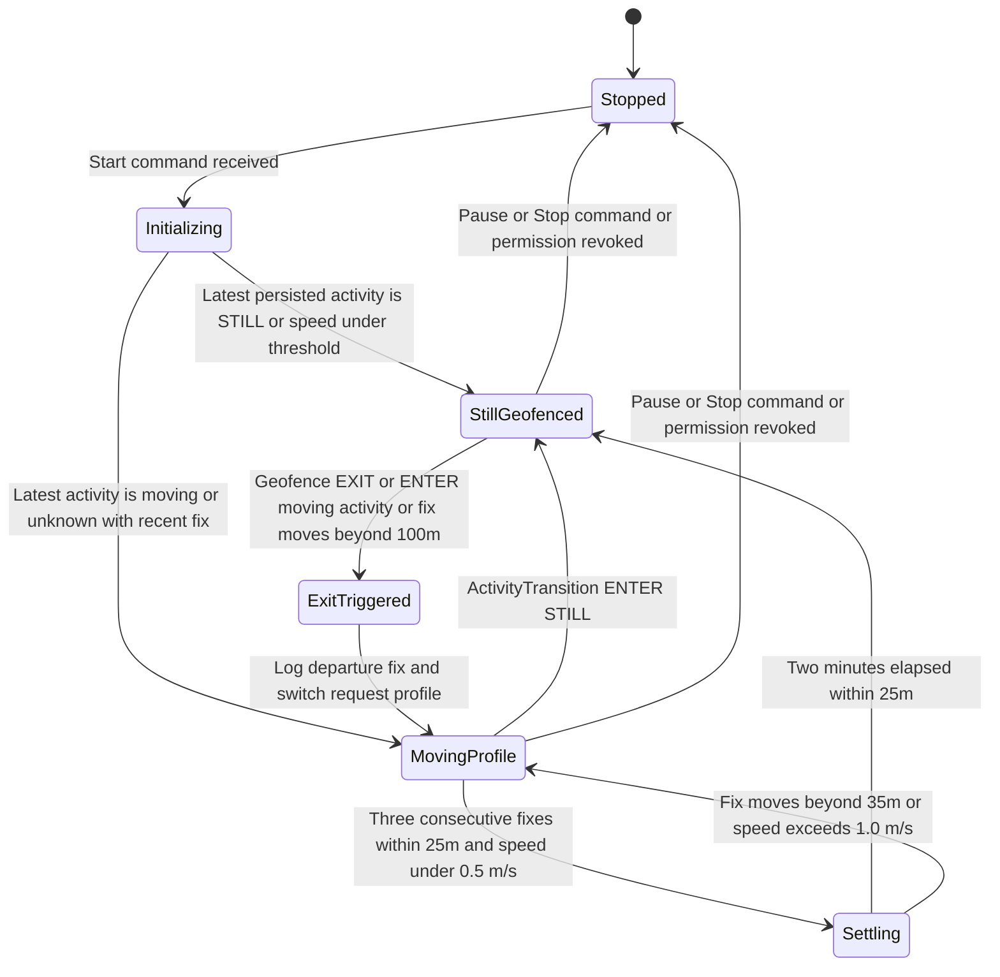

# Stage 1A: Android Capture and Sensor Fidelity

This specification guides engineers modifying `client/location` and `client/database` during Stage 1A of the Android proof of concept. Read it before changing foreground services, Fused Location profiles, geofences, receivers, or Room location capture columns, and verify every change against the battery and Managed Device gates in [07-verification-benchmarks-and-rollout.md](./07-verification-benchmarks-and-rollout.md).

## Current Capture Defects

Inspection of `client/location` identifies six capture bugs that starve reconstruction or waste battery:

1. **Hot startup while stationary.** `ActivityAwareLocationService.startTracking()` in [ActivityAwareLocationService.kt](../../../client/location/src/androidMain/kotlin/app/logdate/client/location/tracking/ActivityAwareLocationService.kt#L240) always calls `applyLocationProfile(LocationProfile.ON_FOOT)`, forcing high-accuracy 30-second GPS polling even when the phone is sitting on a nightstand.
2. **State amnesia across process restarts.** `ActivityAwareLocationService` holds `currentActivityType` and `currentActivitySince` only in `@Volatile` fields (`lines 140-144`). When Android restarts the `START_STICKY` service or the app launches after a crash, it ignores persisted `location_activity` rows.
3. **Indoor stalls from `waitForAccurateLocation(true)`.** [LocationProfile.kt](../../../client/location/src/androidMain/kotlin/app/logdate/client/location/tracking/LocationProfile.kt#L25) enables `setWaitForAccurateLocation(true)` on `PRIORITY_HIGH_ACCURACY` requests. Inside concrete buildings where GPS cannot lock, Play Services withholds fixes indefinitely, creating false `HistoryGap` cuts in Reconstruction.
4. **Cycling conflated with driving.** `ActivityAwareLocationService.onActivityTransition` (`lines 203-205`) routes `DetectedActivity.ON_BICYCLE` into `LocationProfile.IN_VEHICLE` (`50m` displacement), clipping corners on city bike rides.
5. **Slow departure detection.** `LocationProfile.STILL` waits up to `180_000L` ms (`3 minutes`) between balanced-power heartbeats with no exit geofence, delaying departure timestamps by up to 3 minutes when Activity Recognition hesitates.
6. **Unbounded stale fixes and lost sensor accuracy fields.** `AndroidLocation.observedAt` in [AndroidLocationEvidence.kt](../../../client/location/src/androidMain/kotlin/app/logdate/client/location/tracking/AndroidLocationEvidence.kt#L10) accepts any `AndroidLocation` regardless of age, allowing cached locations minutes old to be re-logged as fresh observations. Raw provider name, speed accuracy, vertical accuracy, and `elapsedRealtimeNanos` are discarded.

## Redesigned Location Profiles

Replace the three profiles in [LocationProfile.kt](../../../client/location/src/androidMain/kotlin/app/logdate/client/location/tracking/LocationProfile.kt) with five calibrated profiles. Setting `waitForAccurateLocation` to `false` ensures coarse Wi-Fi continuity fixes arrive indoors instead of stalling into artificial gaps.

| Profile | Priority | Interval | Min Interval | Displacement | Max Delay | `waitForAccurateLocation` | Entry Trigger |
| --- | --- | --- | --- | --- | --- | --- | --- |
| `STILL` | `PRIORITY_BALANCED_POWER_ACCURACY` | 180s | 180s | 0m | 180s | `false` | `STILL` transition or 3-fix settle detector |
| `ON_FOOT` | `PRIORITY_HIGH_ACCURACY` | 20s | 10s | 15m | 45s | `false` | `WALKING`, `RUNNING`, `ON_FOOT`, or geofence exit |
| `CYCLING` | `PRIORITY_HIGH_ACCURACY` | 15s | 8s | 25m | 30s | `false` | `ON_BICYCLE` transition |
| `IN_VEHICLE` | `PRIORITY_HIGH_ACCURACY` | 8s | 4s | 40m | 20s | `false` | `IN_VEHICLE` transition or speed >= 8 m/s |
| `LOW_POWER_FALLBACK` | `PRIORITY_BALANCED_POWER_ACCURACY` | 300s | 180s | 50m | 600s | `false` | Missing Activity Recognition or battery <= 15% without charging |

We rejected continuous 5-second `PRIORITY_HIGH_ACCURACY` across all modes because it drains typical phone batteries within half a day. We can tune intervals per profile from field logs without altering downstream reconstruction because `LocationObservation` records capture cadence independently.

## Capture and Geofence State Machine

This state machine governs `ActivityAwareLocationService` transitions across startup, movement, settling, and geofenced stays.

### Seeded Startup

On `startTracking()`, read the most recent `LocationActivityEntity` from `LocationActivityDao` within the last 12 hours before picking a profile. If the latest unclosed transition is `ENTER` `STILL`, register `LocationProfile.STILL` immediately instead of waking GPS in `ON_FOOT`. If `ACTIVITY_RECOGNITION` permission is denied, start in `ON_FOOT` for 2 minutes and let the three-fix settling detector drop to `STILL` when stationary.

### Dynamic 100-Meter Exit Geofence

When the service enters `StillGeofenced` and stays within 25 meters for 5 minutes:

1. Compute the accuracy-weighted anchor coordinate `(lat, lon)` of the settling fixes.
2. Register one Play Services `Geofence` (`requestId = "logdate:stay_exit"`, radius `100f` meters, transition `GEOFENCE_TRANSITION_EXIT`, `setLoiteringDelay(0)`, `Geofence.NEVER_EXPIRE`) wired to a dedicated `StayExitGeofenceReceiver` using a `FLAG_MUTABLE` `PendingIntent`.
3. Immediately request a single high-accuracy fix and switch `ActivityAwareLocationService` to `ON_FOOT` whenever `StayExitGeofenceReceiver` fires, preserving the exit event timestamp as an observation or transition marker.
4. Remove `"logdate:stay_exit"` on any exit transition, `ACTION_STOP`, or permission loss. Do not persist the geofence across device reboots because `LocationTrackingBootReceiver` already restarts `LocationTrackingManager`.

### Independent Stillness Fallback

Samsung, Xiaomi, and some Pixel builds batch or suppress `ActivityTransitionApi` events when pocketed. Add a kinematic fallback inside `ActivityAwareLocationService` so three consecutive fixes within a 25-meter radius whose reported speeds are all `< 0.5f` m/s (or missing) step the profile down from `ON_FOOT` to `STILL`, and any single fix with `accuracy <= 50f` more than 100 meters from the anchor or speed `>= 1.8f` m/s steps back up immediately.

## Stale-Fix Rejection, Provenance, and Deduplication

Update [AndroidLocationEvidence.kt](../../../client/location/src/androidMain/kotlin/app/logdate/client/location/tracking/AndroidLocationEvidence.kt) and [OptimizedBackgroundLocationReceiver.kt](../../../client/location/src/androidMain/kotlin/app/logdate/client/location/tracking/OptimizedBackgroundLocationReceiver.kt):

1. **Reject stale live-stream fixes.** Compute `ageMs = (SystemClock.elapsedRealtimeNanos() - androidLocation.elapsedRealtimeNanos) / 1_000_000`. In `ActivityAwareLocationService.persistLocation`, drop fixes where `ageMs > 60_000` or `ageMs < -5_000`. In `OptimizedBackgroundLocationReceiver`, allow up to `300_000` ms (`5 minutes`) for batched passive delivery while still dropping hours-old cached fixes.
2. **Enforce coordinate validity at capture.** Drop fixes with non-finite values, `(0.0, 0.0)` exact pairs when `accuracy > 1_000f`, or negative `accuracy`.
3. **Preserve sensor provenance.** Persist `provider` (`gps`, `fused`, `network`), `speedAccuracyMetersPerSecond` (`hasSpeedAccuracy()`), `verticalAccuracyMeters` (`hasVerticalAccuracy()`), and `elapsedRealtimeNanos` in `LocationLogEntity` via Room migration 52 -> 53 ([06-data-models-migrations-and-sync-contracts.md](./06-data-models-migrations-and-sync-contracts.md)). Keep recording `isMock` accurately so Reconstruction v4 can isolate mock tests instead of mixing simulated trips into personal history.
4. **Deduplicate overlapping workers.** In [ScheduledLocationTrackerWorker.kt](../../../client/location/src/androidMain/kotlin/app/logdate/client/location/tracking/ScheduledLocationTrackerWorker.kt) and [LocationTrackingExecutionDecision.kt](../../../client/location/src/commonMain/kotlin/app/logdate/client/location/tracking/LocationTrackingExecutionDecision.kt), keep `shouldRecordPeriodicSample` suppressing WorkManager balanced fixes while `ActivityAwareLocationService.lastFixAt` is fresh, and apply the same age guard against re-persisting identical `(timestamp, latitude, longitude)` fixes emitted by passive listeners.

## Battery Budget, OEM Resilience, and Diagnostics

Define hard battery and recovery targets for Android 14–16 devices:

- **Stationary screen-off budget:** `<= 1.0%` battery per hour (target `<= 2.5%` overnight over 8 hours) by keeping `STILL` on balanced power plus one exit geofence.
- **Active commute budget:** `<= 4.0%` battery per hour while driving or walking continuously, enforced via `displacementMeters` and `maxDelayMillis`.
- **Foreground-service recovery:** When Android denies FGS launch from background (`ForegroundServiceStartNotAllowedException`), persist a recoverable capture-interrupted status surfaced on `HumanLocationHistoryScreen` and schedule `ScheduledLocationTrackerWorker` to record `OPTIMIZED_BACKGROUND` / `BACKGROUND_PERIODIC` fixes until the next app foreground resume re-promotes `ActivityAwareLocationService`.
- **Privacy-safe telemetry:** Emit aggregate capture counters to structured diagnostics (fixes accepted, fixes rejected by stale age, geofence exits triggered, profile switches per hour). Never log raw coordinates, street addresses, or place names to Logcat or Sentry.

## Wear OS Component Boundary Cleanup

Resolve [Wear Location Component TODOs](../../todos/wear-location-components.md) alongside Stage 1A so phone-only manifest entries (`ActivityAwareLocationService`, `DetailedLocationTrackingService`, `ActivityTransitionReceiver`, `OptimizedBackgroundLocationReceiver`, `LocationTrackingBootReceiver`) move into an Android-phone-only source set or manifest split. That removes `tools:ignore="MissingClass"` from `app/wear/src/main/AndroidManifest.xml` without blocking phone capture development. Note that `DetailedLocationTrackingService` is already `@Deprecated`; delete it once no test or DI binding references it.

## Open Unknowns

Play Services `GeofencingClient` exit latency under extreme OEM battery savers (Samsung Sleeping Apps, Xiaomi MIUI background limits, OnePlus Deep Optimization) cannot be measured on Gradle Managed Devices. Stage 1 exit certification in [07-verification-benchmarks-and-rollout.md](./07-verification-benchmarks-and-rollout.md) requires physical multi-vendor dogfooding to verify whether the 100-meter exit radius wakes within 60 seconds of leaving a building.
