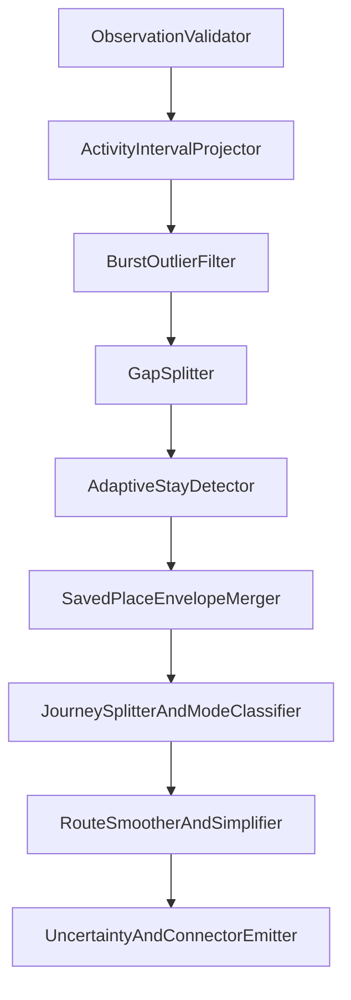

# Stage 1B: Reconstruction v4 and Accuracy Engine

This specification guides domain engineers upgrading `client/domain/src/commonMain/kotlin/app/logdate/client/domain/location/history/` from `ReconstructLocationDay.VERSION = 3` to `VERSION = 4`. Implement these algorithms in pure Kotlin inside `commonMain`, back every step with golden replay benchmarks ([07-verification-benchmarks-and-rollout.md](./07-verification-benchmarks-and-rollout.md)), and export deterministic JSON test vectors ([06-data-models-migrations-and-sync-contracts.md](./06-data-models-migrations-and-sync-contracts.md)) for later Swift and Rust ports.

## Reconstruction v4 Component Pipeline

This component diagram shows the nine stages inside `ReconstructLocationDay` v4 and `LocationHistoryService` that transform raw observations, activity events, and saved places into visits, journeys, gaps, and uncertainty bounds.

## 1. Observation Filtering and Evidence Hygiene

Update [ReconstructLocationDay.kt](../../../client/domain/src/commonMain/kotlin/app/logdate/client/domain/location/history/ReconstructLocationDay.kt#L34-L40) to accept an optional `includeMock: Boolean = false` flag on `invoke`:

- Filter out invalid coordinates (`!hasValidCoordinates()`), `(0.0, 0.0)` fixes when `accuracyMeters == null || accuracyMeters > 100f`, and `isMock` samples unless `includeMock` is explicitly set for test fixtures.
- Deduplicate by `(ownerId, deviceId, id)`, then sort by `(timestamp, id)` so identical recordings always yield byte-identical sample IDs and evidence lists.
- Preserve existing item identity semantics (`"${first.ownerId}:${first.deviceId}:${first.id}"`) so every prior `HistoryCorrection` and `VisitMemoryLink` continues resolving across the v3 to v4 upgrade.

## 2. True Activity State-Interval Projection

`applyActivityEvidence` in [LocationHistoryService.kt](../../../client/domain/src/commonMain/kotlin/app/logdate/client/domain/location/history/LocationHistoryService.kt#L590-L617) currently discards any `ENTER` transition older than `10.minutes` (`line 610`). That breaks every stay or highway trip longer than ten minutes.

Replace point-in-time age cutoff with explicit interval projection:

1. **Boundary pre-load:** Extend [HistoryBoundaryReader.kt](../../../client/domain/src/commonMain/kotlin/app/logdate/client/domain/location/history/HistoryBoundaryReader.kt) to fetch the single latest `ActivityObservation` preceding `contextStart` per `(ownerId, deviceId)`. An overnight `ENTER STILL` recorded at 23:15 now carries into the 06:30 commute without expiring at 23:25.
2. **Interval construction:** Sort deduplicated activity events per `(ownerId, deviceId)` by `(timestamp, transitionType == "EXIT")` so matching exits close before new enters at identical timestamps. Open an interval when `transitionType == "ENTER"` and close it at the earliest of:
   - a matching `EXIT` for the same `activityType`;
   - an `ENTER` for any conflicting `activityType`;
   - the next recording gap longer than `maximumQuietStay` (`30 minutes`), which caps stale orphaned states if the process crashed before `EXIT`.
3. **GPS override of stale `STILL`:** If a projected `STILL` interval overlaps three or more consecutive precise fixes (`accuracyMeters <= 50f`) spanning at least `150 meters` with implied segment speeds `>= 3.0 m/s`, override those samples' effective activity to `TravelMode.UNKNOWN` so kinematic classification can identify the missed trip.

## 3. Multi-Sample Burst Outlier Rejection

`isSpike` in [LocationEvidenceQuality.kt](../../../client/domain/src/commonMain/kotlin/app/logdate/client/domain/location/history/LocationEvidenceQuality.kt#L76-L90) only inspects isolated single samples (`i-1`, `i`, `i+1`). Real indoor Wi-Fi or cell-tower handoffs often produce two or three consecutive displaced fixes before snapping back to the building.

Generalize `preciseSamples` to run a sliding burst check over window lengths `k = 1`, `2`, and `3`:

- Given anchor `pre = candidates[i - 1]` and anchor `post = candidates[i + k]`, verify `post.timestamp - pre.timestamp <= excursionTolerance` (`5 minutes`) and `distanceMeters(pre, post) <= stayRadiusMeters`.
- Check every sample `s` in `candidates[i .. i + k - 1]`: `away = distanceMeters(pre, s)` and `back = distanceMeters(s, post)` both exceed `maxOf(150.0, 2.0 * (s.accuracyMeters ?: 0f))`.
- Demote the burst window out of `preciseIds` (keeping them in `vague` evidence so timelines never lose recording continuity) when EITHER:
  - implied entry and exit speeds both exceed `implausibleSpeedMetersPerSecond` (`70.0 m/s`); OR
  - every burst sample has degraded accuracy (`(s.accuracyMeters ?: 0f) >= 2.5f * maxOf(pre.accuracyMeters ?: 15f, post.accuracyMeters ?: 15f)`) while activity does not report `MOVING_MODES`.

We rejected a hard global speed cap alone because slow Wi-Fi cell-tower teleports (`350m` jump over `20s` = `17.5 m/s`) pass speed checks while failing the round-trip return plus accuracy-degradation check.

## 4. Adaptive Stay Detection and Saved-Place Envelopes

Replace the static `stayRadiusMeters = 100.0` threshold in [StayDetector.kt](../../../client/domain/src/commonMain/kotlin/app/logdate/client/domain/location/history/StayDetector.kt) and [HistoryReconstructionParameters.kt](../../../client/domain/src/commonMain/kotlin/app/logdate/client/domain/location/history/HistoryReconstructionParameters.kt) with three accuracy improvements.

### Dynamic Core Radius

Dense urban streets pack separate venues 60–80 meters apart, while coarse indoor Wi-Fi drifts 90 meters. Compute each candidate stay's effective core radius from the running median accuracy of its anchors:

$$
R_{\text{core}} = \text{clamp}\left(55.0 + 0.75 \cdot \max(0.0, \tilde{\sigma}_{\text{acc}} - 15.0),\; 55.0,\; 100.0\right)
$$

When median GPS accuracy is `<= 15m`, two visits 70 meters apart separate cleanly. When indoor Wi-Fi reports `60m` accuracy, the radius widens to `88.75m` so desk jitter never fragments a stay.

### Saved-Place Envelopes

Pass known `userConfirmed` `SemanticPlace` entries into `ReconstructLocationDay`. When a stay's anchor seed lands within a saved place whose `radiusMeters > R_core` (such as a `400m` university campus or airport terminal), let `belongs()` and `joinSameSpot()` use `place.radiusMeters` capped at `500m`. Walking across a campus concourse stays one visit at that place unless activity enters a sustained `VEHICLE` trip out of the envelope.

### Confirmed Stay Threshold and Oscillation-Safe Drift

Unify the code (`5.minutes`) and stale doc (`2 minutes` in [Human location history](../../implementation/human-location-history.md#L50)) with an explicit two-tier rule:

- **High-confidence quick stop:** `duration >= 3.minutes`, `anchors.size >= 3`, and `medianAccuracy <= 25f` confirms short coffee pickups and transit transfers.
- **Standard stay:** `duration >= 5.minutes` and `anchors.size >= 2` confirms sparse or lower-accuracy stays.

In `StayDetector.drifting()`, add a straightness check (`netDisplacement / totalPathLength > 0.65`) alongside `early.distanceTo(late) > R_core`. Pacing back and forth inside a warehouse yields low straightness and stays a visit, while walking steadily down a sidewalk exceeds `0.65` and splits cleanly into a `JourneyLeg`.

## 5. Spatial Uncertainty and Visit Confidence

Extend `PlaceVisit` in [LocationHistory.kt](../../../shared/model/src/commonMain/kotlin/app/logdate/shared/model/location/LocationHistory.kt) with transient reconstruction fields (computed at read time, never synced):

- `uncertaintyRadiusMeters: Float`: `maxOf(medianAnchorAccuracy ?: 100f, rmsAnchorSpreadMeters)` clamped to `[10f, 1500f]`.
- `confidence: Float`: weighted score in `[0f, 1f]` combining normalized duration (`0.30`), sample density (`0.25`), inverse median accuracy (`0.30`), and activity-stillness agreement (`0.15`).
- `sampleCount: Int`: count of observations supporting the visit.

The map layer ([04-cartographic-map-and-replay-ux.md](./04-cartographic-map-and-replay-ux.md)) uses `uncertaintyRadiusMeters` to draw accuracy halos, and the place matcher ([03-place-identity-resolution-and-memory-linking.md](./03-place-identity-resolution-and-memory-linking.md)) uses it to scale search radii.

## 6. Hybrid Kinematic + Activity Travel-Mode Inference

[TravelModeInferenceProvider.kt](../../../client/domain/src/commonMain/kotlin/app/logdate/client/domain/location/history/TravelModeInferenceProvider.kt) currently computes a majority vote over `activity` and returns `TravelMode.UNKNOWN` whenever Activity Recognition is missing or disabled.

Upgrade `RecordedTravelModeInferenceProvider` into `HybridTravelModeInferenceProvider`:

1. **Primary signal:** If at least `50%` of samples in the leg carry non-`UNKNOWN`, non-`STILL` projected activity intervals, emit the dominant mode with provenance `"activity_interval"`.
2. **Kinematic fallback:** Otherwise, filter consecutive pairs with `dt >= 2s` and `accuracy <= 100f`, compute segment speeds `d / dt`, combine with reported non-zero `speedMetersPerSecond` readings, and evaluate `p50Speed`, `p85Speed`, total path distance, and stop ratio (`fraction < 0.4 m/s`):

| Condition | Inferred Mode | Confidence Band | Provenance |
| --- | --- | --- | --- |
| `p85Speed >= 8.5 m/s` or (`p50Speed >= 6.0 m/s` and `distance >= 500m`) | `TravelMode.VEHICLE` | `0.70–0.90` | `"kinematic_speed"` |
| `p50Speed in 3.5..<8.5 m/s` and `p85Speed < 10.5 m/s` and `distance >= 300m` | `TravelMode.CYCLING` | `0.55–0.75` | `"kinematic_speed"` |
| `p50Speed in 2.3..<3.8 m/s` and `stopRatio < 0.2` and `distance >= 250m` | `TravelMode.RUNNING` | `0.55–0.70` | `"kinematic_speed"` |
| `p50Speed in 0.5..<2.3 m/s` and `p85Speed < 3.5 m/s` | `TravelMode.WALKING` | `0.60–0.80` | `"kinematic_speed"` |
| Fewer than 3 valid pairs or ambiguous jitter (`p50Speed < 0.5 m/s`) | `TravelMode.UNKNOWN` | `0.0` | `"insufficient_kinematics"` |

Do not guess `TravelMode.BUS` or `TravelMode.TRAIN` from kinematics alone. Reserving transit modes for confirmed activity signals or explicit user edits keeps the timeline honest.

## 7. On-Device Route Smoothing and Simplification

Raw Fused Location points zigzag across sidewalks and alleys, inflating calculated route distances by 15–35% and making map polylines look jagged. Add a `RouteSmoother` component inside `ReconstructLocationDay` before creating `JourneyLeg`:

1. **Velocity-gated accuracy smoothing:** Project route points into local East-North meters around the leg midpoint, apply a constant-velocity 2D Kalman pass weighted by `1 / max(accuracyMeters, 5f)^2`, and reject intermediate single-point detours implying lateral acceleration beyond mode bounds (`> 6 m/s^2` walking, `> 12 m/s^2` driving).
2. **Douglas-Peucker simplification:** Run Douglas-Peucker with `epsilon = 5.0` meters while pinning the first point, last point, and any vertex whose turn angle exceeds `35°` with `accuracy <= 25f`.
3. **Computed leg metrics:** Populate `JourneyLeg.distanceMeters` (new transient property computed over the simplified path) and retain `rawRoute` separately from `smoothedRoute` so editing or replay inspection never loses raw evidence.
4. **Synthetic connector endpoints:** Populate `JourneyLeg.endpointCoordinates: Pair<Pair<Double, Double>, Pair<Double, Double>>?` on connectors emitted by `withConnectors()` (`ReconstructLocationDay.kt:117-124`). That lets the map draw a subtle dashed connector line between adjacent visits instead of dropping empty routes (`HumanHistoryMap.kt:69`).

## 8. Capture-Timezone Day Framing and Multi-Device Fusion

Fix timezone distortion ([Human location history](../../implementation/human-location-history.md#L156)) and multi-device selection:

- **Capture-zone resolution:** For any requested `LocalDate`, query a wide `start - 14.hours` to `end + 14.hours` window first, group valid observations for the candidate day, and resolve `effectiveZone`:
  1. Use the most frequent valid `timeZoneId` among the day's observations.
  2. Fall back to the nearest observation within 7 days carrying a `timeZoneId`.
  3. Fall back to `TimeZone.currentSystemDefault()`.
  4. When a day contains samples from two or more distinct UTC offsets (a flight day), flag `isMultiZoneDay = true` and attach `displayZoneId` per `LocationDayItem` so arrival and departure times format in the local wall time where each occurred.
- **Reactive ViewModel zone:** Remove the constructor-cached `private val zone = TimeZone.currentSystemDefault()` in [HumanLocationHistoryViewModel.kt](../../../client/feature/location-timeline/src/commonMain/kotlin/app/logdate/feature/location/timeline/ui/history/HumanLocationHistoryViewModel.kt#L49) and observe timezone changes on lifecycle resume.
- **Optional non-overlapping multi-device fusion:** Keep single primary device selection as the default (`selectedDeviceId`) so simultaneous dual-device jitter never interleaves. Add an `"all"` virtual source in `selectDaySources` (`LocationHistoryService.kt:313-352`) that accepts the primary device's items and splices items from secondary devices only inside recording gaps longer than `maximumGap` (`10 minutes`), tagging each fused item with its `sourceDeviceId`.

## What Would Change This Design

If golden replay evaluation in [07-verification-benchmarks-and-rollout.md](./07-verification-benchmarks-and-rollout.md) shows `3.minutes` with `<= 25f` accuracy promotes red-light traffic jams into visits on highway trips, add a `trafficSignalGuard` requiring median speed `< 0.5 m/s` and zero `VEHICLE` interval overlap before confirming stays under `5 minutes`.
