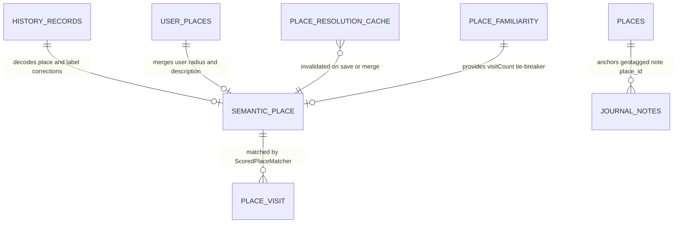

# Stage 1C: Place Identity, Resolution, Caching, and Timeline Unification

This specification guides data and domain engineers fixing place matching, Google Places enrichment, `PlaceResolutionCache`, visit-memory linking, and main Timeline place display in `logdate-mobile`. Apply the schema additions in [06-data-models-migrations-and-sync-contracts.md](./06-data-models-migrations-and-sync-contracts.md) alongside these changes.

## Unifying Fragmented Place Models

Today three separate place concepts coexist without a single scoring boundary:

- `PlaceEntity` (`places` table, [PlaceEntity.kt](../../../client/database/src/commonMain/kotlin/app/logdate/client/database/entities/PlaceEntity.kt)) stores ActivityPub-shaped note foreign keys (`radius`, `units`, `ap_uri`).
- `UserPlaceEntity` (`user_places` table, [UserPlaceEntity.kt](../../../client/database/src/commonMain/kotlin/app/logdate/client/database/entities/UserPlaceEntity.kt)) stores user-saved places with `radius_meters`, yet `OfflineFirstUserPlacesRepository` never syncs to `/api/v1/location-history` directly and [LocationHistoryService.kt](../../../client/domain/src/commonMain/kotlin/app/logdate/client/domain/location/history/LocationHistoryService.kt#L265) drops `radiusMeters` when mapping to `SemanticPlace`.
- `SemanticPlace` ([LocationHistory.kt](../../../shared/model/src/commonMain/kotlin/app/logdate/shared/model/location/LocationHistory.kt#L48-L56)) stores synced places inside `history_records` with no radius or category.

This entity-relationship diagram shows how the unified `SemanticPlace` projection reconciles local user places, synced place records, note places, and cached lookups without a destructive table rewrite.

Extend `SemanticPlace` with `radiusMeters: Double = 75.0` and `category: PlaceCategory? = null` (`HOME`, `WORK`, `FOOD`, `COFFEE`, `SHOPPING`, `OUTDOORS`, `FITNESS`, `TRANSIT`, `LODGING`, `HEALTH`, `ENTERTAINMENT`, `OTHER`). When `LocationHistoryService` maps `UserPlaceEntity` into `SemanticPlace`, copy `radiusMeters` directly instead of dropping it, and propagate `PlaceCategory` in both `SemanticPlace` and `UserPlaceEntity` (via Room migration 52 -> 53).

## Scored Place Matcher

In [LocationHistoryService.kt](../../../client/domain/src/commonMain/kotlin/app/logdate/client/domain/location/history/LocationHistoryService.kt#L378-L382), `buildSnapshot` filters saved places within a fixed `75m` radius and calls `.singleOrNull()`. Whenever two saved places sit within 75 meters—such as a coffee shop below a coworking space—`.singleOrNull()` returns `null` and erases both names.

Replace `.singleOrNull()` with `ScoredPlaceMatcher`:

1. **Candidate gate:** Collect every non-deleted, alias-resolved `SemanticPlace` where:

$$
d(\text{visit}, \text{place}) \le \max(\text{place.radiusMeters},\; \text{visit.uncertaintyRadiusMeters}) + 25.0
$$

2. **Candidate score:** Compute `score` for each candidate:

$$
\text{score} = \exp\!\left(-\left(\frac{d}{\text{effectiveRadius}}\right)^2\right) \cdot w_{\text{confirmed}} \cdot w_{\text{familiarity}} \cdot w_{\text{explicit}}
$$

   where `effectiveRadius = max(place.radiusMeters, visit.uncertaintyRadiusMeters, 45.0)`, `w_confirmed = 1.5` if `place.userConfirmed` else `0.85`, `w_familiarity = 1.0 + 0.15 * ln(1 + visitCount)` from `PlaceFamiliarityRepository`, and `w_explicit = 1.25` when `place.id == explicitCorrectionPlaceId`.

3. **Assignment and disambiguation:**
   - Assign the highest-scoring candidate when `top.score >= 0.45`.
   - If the runner-up scores within `0.15` of `top.score`, still assign `top` so the card is named, and populate `PlaceVisit.candidatePlaceIds` (up to 3 IDs) plus `PlaceVisit.needsDisambiguation = true` so the timeline card shows `"Were you at <Runner-Up>?"`.
   - Do not modify an existing explicit `HistoryField.PLACE` correction; user edits always win unconditionally.

## Smarter External POI Enrichment and Geocoding

Three bugs break automatic naming today: [GooglePlacesExternalPlacesProvider.kt](../../../client/location/src/androidMain/kotlin/app/logdate/client/location/places/GooglePlacesExternalPlacesProvider.kt#L27-L87) searches a fixed `250m` radius, [ResolveLocationToPlaceUseCase.kt](../../../client/domain/src/commonMain/kotlin/app/logdate/client/domain/places/ResolveLocationToPlaceUseCase.kt#L49) picks `firstOrNull()` regardless of duration or POI type, and [HumanLocationHistoryViewModel.kt](../../../client/feature/location-timeline/src/commonMain/kotlin/app/logdate/feature/location/timeline/ui/history/HumanLocationHistoryViewModel.kt#L442-L472) saves the external POI's coordinates (`result.suggestion.latitude`) so any POI > 75m from the visit center fails to match back on the next snapshot.

Fix the full enrichment pipeline:

1. **Uncertainty-scaled search radius:** Pass `radiusMeters = clamp(visit.uncertaintyRadiusMeters * 1.5, 60.0, 120.0)` into `ExternalPlacesProvider.searchNearbyPlaces(location, radiusMeters)`.
2. **Dwell-time and overnight residential guard:**
   - Down-rank or drop transient utility POIs (`atm`, `parking`, `mailbox`, `bus_stop`, `electric_vehicle_charging_station`) when stay duration exceeds `45 minutes`.
   - Suppress automatic commercial POI naming (`"Near <Neighbor's LLC>"`) whenever a stay lasts `>= 5 hours` and overlaps `00:00–05:00` local time unless distance `<= 25m` or the place matches an existing `userConfirmed` place. Fall back to structured street/neighborhood geocoding and emit an inline `"Set as Home?"` prompt.
3. **Structured reverse geocoding:** Extend `GeocodedAddress` and [AndroidReverseGeocodingProvider.kt](../../../client/location/src/androidMain/kotlin/app/logdate/client/location/places/AndroidReverseGeocodingProvider.kt#L56-L63) with `subThoroughfare` (`featureName` street number when numeric) and `countryCode`. Format fallback labels cleanly (`"1420 Market St"` or `"Mission District, San Francisco"` rather than `"Somewhere in San Francisco"` when finer context exists).
4. **Explicit suggestion binding:** When `HumanLocationHistoryViewModel.enrich` resolves a `PlaceSuggestion` or `CoarseLocation`, save the `SemanticPlace` AND record an unconfirmed `HistoryField.SUGGESTED_PLACE` correction targeting `visit.evidenceIds.first()`. `ApplyHistoryEdits` applies `SUGGESTED_PLACE` whenever no confirmed `HistoryField.PLACE` exists, ending the 75m mismatch drop permanently.

## Persistent, Thread-Safe `PlaceResolutionCache`

[PlaceResolutionCache.kt](../../../client/domain/src/commonMain/kotlin/app/logdate/client/domain/places/PlaceResolutionCache.kt#L33-L68) has four bugs: `linkedMapOf()` is insertion-ordered rather than access-ordered LRU, concurrent ViewModel enrichment mutates it without synchronization, `.toInt()` truncation maps both `+0.0005` and `-0.0005` to `0` across the equator and prime meridian, and transient offline errors cache `UnknownLocation` for 24 hours.

Replace it with a two-tier `PersistentPlaceResolutionCache`:

- **Cell key:** `floor(latitude * 2000).toInt() to floor(longitude * 2000).toInt()` (~55m lattice, `floor()` avoids 0° collapse).
- **Synchronization and eviction:** Guard an in-memory access-ordered LRU (`maxSize = 256`) with a Kotlin `Mutex` and per-key coalesced single-flight `Deferred` lookups so ten visits at the same café trigger one network call instead of ten.
- **Room backing (`place_resolution_cache` table):** Persist resolved `ExternalSuggestion` and `CoarseLocation` payloads across app restarts (see DDL in [06-data-models-migrations-and-sync-contracts.md](./06-data-models-migrations-and-sync-contracts.md)).
- **Tiered TTL and invalidation:**
  - `ExternalSuggestion` / `CoarseLocation`: `30 days` TTL.
  - `UnknownLocation` (offline or API error): `5 minutes` negative backoff so reconnecting recovers immediately.
  - `UserDefinedPlace`: never trust stale cache entries; invalidate the cell and its 8 immediate neighbors (`dx in -1..1, dy in -1..1`) whenever `UserPlacesRepository` or `LocationHistoryService` creates, updates, renames, or merges a place.

## Scored `AssociateVisitMemories` and Main Timeline Unification

### Visit-Memory Linking (`AssociateVisitMemories.kt`)

[AssociateVisitMemories.kt](../../../client/domain/src/commonMain/kotlin/app/logdate/client/domain/location/history/AssociateVisitMemories.kt#L26-L33) requires strict `creationTimestamp in it.start..it.end` and `distance <= 75` with `.singleOrNull()`. Fix it with three rules:

1. Keep explicit `VisitMemoryLink` records authoritative (`explicit.isNotEmpty()` wins unconditionally).
2. Expand spatial tolerance to `max(100.0, visit.uncertaintyRadiusMeters + 35.0)` and temporal edge tolerance to `±5.minutes` around `[visit.start, visit.end]`.
3. Score overlapping candidate visits by temporal containment + inverse spatial distance and pick `maxByOrNull` instead of `.singleOrNull()`, breaking exact ties by choosing the visit containing the note timestamp strictly inside `[start, end]`.

### Unifying Main Timeline (`GetTimelineUseCase.kt` and `InferMomentsUseCase.kt`)

`extractPlacesVisited` in [GetTimelineUseCase.kt](../../../client/domain/src/commonMain/kotlin/app/logdate/client/domain/timeline/GetTimelineUseCase.kt#L242-L295) only reads `JournalNote.location`, missing visited places without notes and printing raw coordinates (`"${roundCoordinate(latitude)}, ${roundCoordinate(longitude)}"`) whenever `displayName` is `null`.

Update `GetTimelineUseCase` and `InferMomentsUseCase` to consume `LocationHistoryService.observeRange` for the loaded timeline dates:

- Merge confirmed `PlaceVisit` records (`confirmedStay == true` and resolved `place != null`) into `TimelineDay.placesVisited` in chronological order, deduplicating by resolved `place.id` or `SemanticPlace` cluster.
- When a note carries raw coordinates without a `NotePlace`, look up any overlapping `PlaceVisit` or run `PlaceResolutionCache` before falling back, suppressing raw decimal strings from Timeline headers unless no coarse locality exists.

## Open Questions

1. Should `UserPlacesRepository` writes inside Settings or Editor automatically mirror into `history_records` (`recordType = "place"`) at write time so user-created places sync even before a visit matches them? Mirroring on write keeps cross-device place lists identical in Stage 2 (`logdate-apple`) and is the planned path in [06-data-models-migrations-and-sync-contracts.md](./06-data-models-migrations-and-sync-contracts.md).
