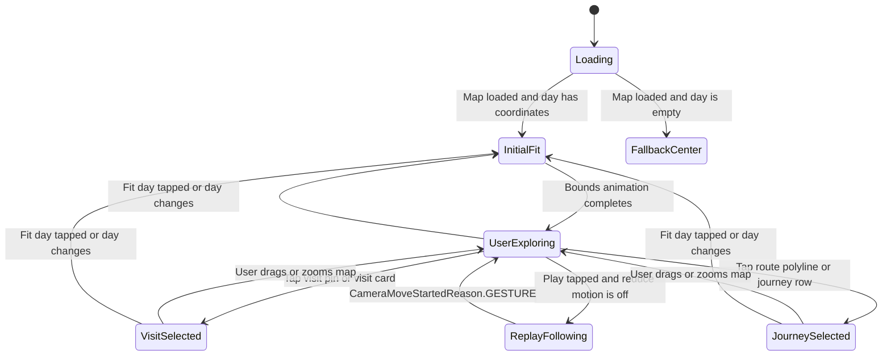

# Stage 1D: Cartographic Map and Replay UX

This specification directs Compose UI and Maps engineers upgrading [NativeHistoryMap.android.kt](../../../client/feature/location-timeline/src/androidMain/kotlin/app/logdate/feature/location/timeline/ui/history/NativeHistoryMap.android.kt), [HumanHistoryMap.kt](../../../client/feature/location-timeline/src/commonMain/kotlin/app/logdate/feature/location/timeline/ui/history/HumanHistoryMap.kt), and `HistoryReplay` inside [HumanLocationHistoryContent.kt](../../../client/feature/location-timeline/src/commonMain/kotlin/app/logdate/feature/location/timeline/ui/history/HumanLocationHistoryContent.kt). Every map change must maintain a single mounted `GoogleMap` instance inside `WorkspaceSupportingSheet`, respect `LocalSupportingOverlap`, and preserve offline canvas fallback behavior when Maps is unavailable.

## Current Map and Replay Deficiencies

1. **Default red/azure pins with no semantic hierarchy.** `NativeHistoryMap.android.kt:125-137` renders identical stock pins without visit order numbers, category icons, memory previews, or selection callouts.
2. **Unstyled gray polylines and invisible connectors.** `NativeHistoryMap.android.kt:145-155` draws every `JourneyLeg` in `Color(0xFF687381)` (`4f` width) regardless of `TravelMode`, and `HumanHistoryMap.kt:65-71` drops synthetic connectors because `route` is empty.
3. **Broken journey camera targeting and Las Vegas default.** Selecting a `JourneyLeg` zooms to `points.firstOrNull()` at level `15f` (`NativeHistoryMap.android.kt:87-93`) instead of framing the route's bounds, and empty days initialize at `LatLng(36.17, -115.14)` (`line 57`).
4. **No dark-mode or clutter-reduced map style.** Default bright Google Maps tiles wash out in dark mode and crowd the screen with commercial POI labels that compete with user visits.
5. **Choppy discrete Replay.** `HumanLocationHistoryViewModel.replay` ([HumanLocationHistoryViewModel.kt](../../../client/feature/location-timeline/src/commonMain/kotlin/app/logdate/feature/location/timeline/ui/history/HumanLocationHistoryViewModel.kt#L157-L168)) steps `selectedItemId` every `2500ms` with zero polyline animation, progress trail, or speed controls.

## Custom Semantic Markers and Zoom-Aware Clustering

Replace `BitmapDescriptorFactory.defaultMarker` with pre-rendered Compose/Canvas `BitmapDescriptor` sprites cached in an LRU descriptor cache keyed by `(kind, ordinal, category, selected, hasMemory, isDark)`. Rendering bitmaps once per state tuple avoids Compose allocation overhead on map pan and zoom.

| Item State | Visual Spec on Map | Z-Index | Tap Behavior |
| --- | --- | --- | --- |
| Confirmed visit (`Your day`) | `28dp` circular badge with white `2dp` rim, category fill color, and white tabular visit number (`1`, `2`, `3`) | `10f` | Selects visit, animates camera, scrolls sheet to card |
| Visit with photos | `34dp` badge with `2dp` primary ring and memory-count pip (`+N`) in top-right corner | `15f` | Selects visit and surfaces memory preview chip |
| Selected visit or place | Scales `1.25x`, elevation shadow halo, floating label pill above pin (`"North Beach Cafe · 42m"`) | `50f` | Opens detail inspector on second tap |
| Approximate / clue visit | `20dp` muted translucent ring (`35%` alpha fill, dashed stroke) with `6dp` center dot | `5f` | Selects clue and shows uncertainty circle |
| Cluster (`Your places`, zoom `< 13f`) | Rounded capsule pill showing place count (`"14"`) and dominant category dot | `20f` | Zooms smoothly into cluster bounds (`maxZoom = 15f`) |
| Replay puck (`HistoryReplay` active) | `22dp` glowing accent dot with directional chevron aligned to smoothed segment bearing | `100f` | Pauses playback on tap and holds position |

For `Your places`, apply grid/distance clustering driven by `cameraPositionState.position.zoom` (thresholds `< 8f`, `8f..<11f`, `11f..<13.5f`, unclustered `>= 13.5f`) and compute cluster centroids weighted by visit count rather than unweighted arithmetic averages.

## Travel-Mode Polylines, Connectors, and Uncertainty Halos

Style every `JourneyLeg` polyline using its `TravelMode` and `smoothedRoute` ([02-reconstruction-v4-and-accuracy-engine.md](./02-reconstruction-v4-and-accuracy-engine.md#7-on-device-route-smoothing-and-simplification)), and draw synthetic connectors between consecutive visits using `endpointCoordinates`:

| Mode | Light Stroke | Dark Stroke | Width (`default / selected`) | Pattern (`PatternItem`) | Cap / Joint |
| --- | --- | --- | --- | --- | --- |
| `WALKING` | `#2B7A78` | `#64DFDF` | `6f / 10f` | `Dot()`, `Gap(10f)` | `RoundCap` |
| `RUNNING` | `#D95D39` | `#FF8C66` | `6f / 10f` | `Dash(18f)`, `Gap(8f)` | `RoundCap` |
| `CYCLING` | `#3A86FF` | `#72B0FF` | `7f / 11f` | `Dash(26f)`, `Gap(10f)` | `RoundCap` |
| `VEHICLE` / `DRIVING` | `#4F46E5` | `#938EFF` | `8f / 12f` | Solid line | `RoundCap`, `JointType.ROUND` |
| `BUS` / `TRAIN` | `#7C3AED` | `#B794F4` | `8f / 12f` | Solid with inner `3f` highlight | `RoundCap`, `JointType.ROUND` |
| `UNKNOWN` (recorded) | `#687381` | `#9AA5B1` | `6f / 10f` | `Dash(14f)`, `Gap(10f)` | `RoundCap` |
| Synthetic connector | `#8B949E` (`45%` alpha) | `#9AA5B1` (`45%` alpha) | `4f / 7f` | `Dot()`, `Gap(16f)` | `RoundCap` |

Whenever a `PlaceVisit` with `!confirmedStay` or `uncertaintyRadiusMeters > 40f` is selected, draw a Google Maps `Circle` centered on `(visit.latitude, visit.longitude)` with `radius = visit.uncertaintyRadiusMeters.toDouble()`, `12%` primary fill alpha, and `45%` primary stroke alpha so accuracy bounds stay honest.

## Cartographic Styling, Camera State Machine, and Controls

### Map Style and Fallback Center

Provide bundled raw JSON `MapStyleOptions` resources in `client/feature/location-timeline/src/androidMain/res/raw/`:

- `map_style_light.json`: soft warm land and water palette muting saturated highway yellows and hiding third-party `poi.business` clutter at zoom `< 16f` while keeping parks, transit stations, and neighborhood names legible.
- `map_style_dark.json`: charcoal-slate base tuned for `WorkspaceSurface` dark theme so cyan/indigo routes and numbered visit markers pop without glare.
- Remove `LatLng(36.17, -115.14)` completely. Resolve initial fallback coordinates from: (1) most recent `PlaceVisit` in local history, (2) `LocationTrackingSettings.defaultLocation`, (3) a world-overview `zoom = 2f` camera.

### Map Camera State Machine

This state machine defines how user gestures, day switches, selections, and Replay share camera control without fighting user panning.

Fix `LaunchedEffect(selectedId, loaded)` in [NativeHistoryMap.android.kt](../../../client/feature/location-timeline/src/androidMain/kotlin/app/logdate/feature/location/timeline/ui/history/NativeHistoryMap.android.kt#L83-L97):

- For a `PlaceVisit`, animate to `LatLng(visit.latitude, visit.longitude)` at zoom `16f` with `GoogleMap` `contentPadding` already offset by `LocalSupportingOverlap` (`+ 8.dp`) so the pin lands centered in the unobstructed top area above the sheet.
- For a `JourneyLeg`, compute `LatLngBounds` across all `smoothedRoute` points (or `endpointCoordinates` for connectors) and call `CameraUpdateFactory.newLatLngBounds(bounds, 64)`. Only animate when `points.distinct().size >= 2`.
- Keep `onMapLoaded` resetting timeout state and ensure `LocalSupportingOverlap` keeps Google Maps legal attribution above the bottom sheet edge at all extents.

### Floating Map Controls

Mount a compact vertical pill cluster in the top-trailing corner of the map focus panel (using `workspaceControlBackdrop` / `WorkspaceSurface.Raised` per [Adaptive Home workspace](../../reference/architecture/home-workspace.md)):

- **Fit day (`Icons.Default.CenterFocusStrong`):** Re-frames the active day's full `LatLngBounds` (`padding = 48dp`).
- **Map type (`Icons.Default.Layers`):** Toggles `MapType.NORMAL` (styled JSON) and `MapType.HYBRID` (satellite + street labels).
- **Current position indicator (Today only):** Shows a subtle non-tracking blue dot on the `Your day` map when viewing Today and location permission is already granted without turning on `myLocationButtonEnabled` or polling extra GPS.

## Continuous Animated History Replay

Upgrade `HistoryReplay` in [HumanLocationHistoryViewModel.kt](../../../client/feature/location-timeline/src/commonMain/kotlin/app/logdate/feature/location/timeline/ui/history/HumanLocationHistoryViewModel.kt#L146-L174) and [HumanLocationHistoryContent.kt](../../../client/feature/location-timeline/src/commonMain/kotlin/app/logdate/feature/location/timeline/ui/history/HumanLocationHistoryContent.kt#L423-L467):

1. **Precomputed playback timeline:** Flatten the day's items into a piecewise arc-length schedule (`ReplayTimeline`) spanning `[dayFirstTimestamp, dayLastTimestamp]` with fixed playback duration (`20 seconds` at `1x`, scaled by `1x`, `2x`, or `4x`).
2. **Smooth 60fps progress loop:** While `replayPlaying == true`, advance normalized `replayProgress in 0f..1f` at frame cadence (`withFrameMillis`) or 33ms ticks, deriving:
   - current interpolated puck `(latitude, longitude, bearingDegrees)` along `JourneyLeg.smoothedRoute` or paused cleanly at `PlaceVisit` coordinates;
   - highlighted trail prefix (drawing completed segments at full alpha and upcoming segments dimmed at `30%` alpha);
   - current `activeItemId` and formatted local wall-clock timestamp chip (`"2:14 PM · Walking"`).
3. **Interactive scrubber and reduced motion:** Dragging the `Slider` smoothly scrubs the puck across routes in real time instead of snapping only to visit indices. When `rememberSystemReduceMotion()` is `true`, hide auto-play animation and keep discrete previous/next item stepping with immediate `camera.move` jumps.

## Non-Android Map Targets

Keep [HumanHistoryMap.kt](../../../client/feature/location-timeline/src/commonMain/kotlin/app/logdate/feature/location/timeline/ui/history/HumanHistoryMap.kt) fast and interactive for Compose previews, desktop JVM tests, and offline fallback states by rendering the same `TravelMode` stroke patterns and `uncertaintyRadiusMeters` circles on its fallback `Canvas`. Implementing `MKMapView` in [NativeHistoryMap.ios.kt](../../../client/feature/location-timeline/src/iosMain/kotlin/app/logdate/feature/location/timeline/ui/history/NativeHistoryMap.ios.kt) stays deferred behind the Stage 1 Android proof of concept and `logdate-apple` alignment described in [08-macos-display-and-apple-tracking.md](./08-macos-display-and-apple-tracking.md).
