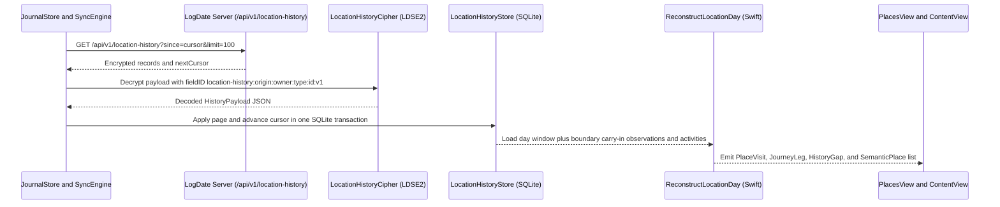

# Stages 2–4: macOS Location Display, Apple-Wide Tracking, and Deferred Clients

This specification guides engineers working across `logdate-apple`, `logdate-linux`, and `logdate-web` after Stage 1 (`logdate-mobile` Android proof of concept) clears every gate in [07-verification-benchmarks-and-rollout.md](./07-verification-benchmarks-and-rollout.md).

## Stage 2: macOS Location Display (`logdate-apple`)

macOS is a reflection, reading, and editing desktop client. It must display Android-captured location history, route maps, visited places, and inline timeline place badges without adding macOS background GPS tracking or location permissions.

### Data Sync and Reconstruction Sequence

This sequence diagram shows how the macOS app fetches encrypted `LDSE2` batches from `/api/v1/location-history`, decrypts them with the synced account key, persists them locally, and renders MapKit views.

### `LogDate/SharedCore/` Components to Add

1. **`LocationHistoryAPI.swift`:** Typed HTTP client matching [LocationHistoryApiClient.kt](../../../client/networking/src/commonMain/kotlin/app/logdate/client/networking/LocationHistoryApiClient.kt) (`GET /api/v1/location-history?since=&limit=` and `PUT /api/v1/location-history` for user edits such as renaming a place, merging places, fixing times, or deleting visits).
2. **`LocationHistoryCipher.swift`:** Thin wrapper around `SyncFieldCipher.swift` (`LogDate/SharedCore/SyncFieldCipher.swift`) binding exact field IDs: `"location-history:\(origin):\(owner):\(recordType):\(id):v1"`. Notice that `origin` must strip trailing `/` exactly like `LocationHistorySyncEngine.kt:178`.
3. **`LocationHistoryStore.swift`:** Encrypted SQLite tables inside `LocalJournalDatabase.swift` matching `history_records` and `history_cursors`, enforcing tombstone non-resurrection (`deleted = 1`) and transactional page+cursor commits.
4. **`ReconstructLocationDay.swift`, `ApplyHistoryEdits.swift`, and `ScoredPlaceMatcher.swift`:** Pure Swift ports of Stage 1B and Stage 1C algorithms (`VERSION = 4`), tested directly against every fixture in `shared/test-vectors/location-history-v4/` ([06-data-models-migrations-and-sync-contracts.md](./06-data-models-migrations-and-sync-contracts.md#shared-cross-platform-reconstruction-test-vectors)).
5. **Local Mac edits upload:** When a Mac user renames a place, adjusts visit times, links a memory, or deletes a visit, persist dirty `HistoryRecord` rows (`correction`, `place`, `manual`, or observation tombstone) with incremented `deviceVersion` and upload via `PUT /api/v1/location-history`. Handle HTTP 409 conflicts by displaying side-by-side choices alongside `JournalConflictReviewRow.swift`.

### Native macOS SwiftUI + MapKit UI

- **New `Places` sidebar item (`ContentView.swift`):** Add `.places` to `SidebarItem` (`ContentView.swift:13-18`) alongside `.timeline`, `.journals`, and `.search`.
- **`PlacesView.swift` (HSplitView / NavigationSplitView):**
  - Left/top calendar & day timeline inspector: 7-day strip with activity dots, date picker, timezone badge (`"JST · UTC+9"`), chronological visits with photo thumbnails, mode-styled journey summaries, gaps, and `"Your places"` searchable collection mode.
  - Right detail canvas: native SwiftUI `Map` (`MapKit`) rendering numbered category annotations, `TravelMode`-styled `MapPolyline` routes (dashed walk, solid drive, dimmed connector), `MapCircle` uncertainty halos, dark/light system map styling, and keyboard shortcuts (`[` / `]` for previous/next day, `Space` for Replay play/pause).
  - Editing sheets/popovers: rename/pick place (using `MKLocalSearch` on macOS for nearby place suggestions when online), edit `radiusMeters`, merge places, adjust arrival/departure times, or add a missing visit.
- **Main Timeline and Reading Pane Integration:** Surface confirmed day `PlaceVisit` chips in `ContentView.swift`'s timeline day groups and display a quiet location pill (`"North Beach Cafe · 2:10 PM"`) in the header of `MarkdownReadingView.swift` when a note overlaps or links to a `PlaceVisit`.

### Stage 2 Verification Gate

Before starting Stage 3:

- Swift unit tests pass 100% of `shared/test-vectors/location-history-v4/` fixtures with zero centroid/boundary divergence from Kotlin.
- Headless loopback integration test (mirroring `SyncContentTests.swift` / `NativeJournalSyncHarness` pattern) uploads synthetic `LDSE2` location history from the Kotlin server/client harness, pulls and decrypts it on `JournalStore`, and asserts identical visits and edits round-tripped back to the server.
- Visual snapshot review of `PlacesView` in light/dark mode and empty/populated/conflict states on macOS.

## Stage 3: Apple-Wide Location Tracking (`logdate-apple` iOS/iPadOS/watchOS)

Once Stage 2 macOS display works reliably against Android-synced records, add location capture across Apple mobile devices.

### Architecture Choice: Native `logdate-apple` vs KMP iOS

`logdate-mobile` currently contains unimplemented KMP iOS stubs (`IosDeviceLocationTracker.kt`, `NativeHistoryMap.ios.kt` showing `"Map unavailable on this device"`), while `logdate-apple` is the active native SwiftUI multiplatform app (`iOS`, `macOS`).

Implement Apple location capture and MapKit Places natively inside `logdate-apple`'s shared Swift core (`LogDate/SharedCore/` + iOS conditional compilation `#if os(iOS)`), rather than splitting Apple features across Compose Multiplatform and SwiftUI. Keep `client/location/src/iosMain` and `client/feature/location-timeline/src/iosMain` in `logdate-mobile` compiling cleanly without expanding dead stubs. We would reverse this only if `logdate-apple` were retired in favor of Compose Multiplatform on iOS.

### Apple Sensor Capture Pipeline (`#if os(iOS)`)

Use Apple's energy-tiered CoreLocation APIs instead of brute-force continuous GPS polling:

1. **Authoritative low-power stay boundaries (`CLVisit`):** Call `CLLocationManager.startMonitoringVisits()`. Persist arriving/departing `CLVisit` events as high-value stay anchors and synthetic transitions while still feeding raw `LocationObservation` pings so Reconstruction v4 works uniformly across Android and iOS devices.
2. **Background wake-ups (`startMonitoringSignificantLocationChanges()`):** Ensures app relaunch in the background after cell-tower movements (`~500m`), seeding active sampling when a trip begins.
3. **Adaptive foreground/background `CLLocationManager`:**
   - Stationary: drop `desiredAccuracy` to `kCLLocationAccuracyHundredMeters` with `distanceFilter = 100`, relying on `CLVisit` + significant-change wake-ups.
   - Moving (`CMMotionActivityManager` reports walking, running, cycling, or automotive): escalate temporarily to `kCLLocationAccuracyBest`, `distanceFilter = 15m` (walking) / `40m` (driving), `pausesLocationUpdatesAutomatically = false`, and `allowsBackgroundLocationUpdates = true` (with `showsBackgroundLocationIndicator = false` for Always-authorized passive history, or `true` during explicit live workouts/sessions per App Store review rules).
   - Step back down to low power once `CMMotionActivity.stationary` holds or 3 fixes remain within `25m` for 2 minutes.
4. **Motion and geocoding:** Map `CMMotionActivity` samples into `ActivityObservation` rows (`STILL`, `WALKING`, `RUNNING`, `CYCLING`, `IN_VEHICLE`) using `ENTER`/`EXIT` change timestamps, and reuse `CLGeocoder` + `MKLocalPointsOfInterestRequest` (`MKLocalSearch`) backed by a SQLite `place_resolution_cache` matching Stage 1C.
5. **Offline queue and `LDSE2` upload:** Stage iOS observations and activities into `LocationHistoryStore` and batch upload via `PUT /api/v1/location-history` on background `BGAppRefreshTask` / foreground sync.

### Multi-Device Continuity (Android + iPhone + Mac)

With both Android and iPhone recording onto one account and macOS viewing/editing both:

- Each device writes under its own `InstallationDeviceID.swift` (`deviceId`), keeping `ReconstructLocationDay` per-device by default so phone and iPad pings never fight each other.
- Stage 1B `"All devices"` non-overlapping gap-fill fusion and human device labels (`UserDeviceEntity` / `AccountDeviceAPI.swift`) operate uniformly across Android, iPhone, and iPad recordings.
- Concurrent edits from macOS and Android generate standard `HistoryCorrection` conflict forks surfaced cleanly in both apps' conflict review dialogs.

### Apple Entitlements and App Store Privacy Gate

Update `LogDate/Info.plist`, `LogDate/LogDate.entitlements`, and `LogDate/PrivacyInfo.xcprivacy` before enabling iOS capture:

- Add `NSLocationWhenInUseUsageDescription`, `NSLocationAlwaysAndWhenInUseUsageDescription`, and `NSMotionUsageDescription` explaining user-owned memory history clearly.
- Enable `UIBackgroundModes` (`location`) only on iOS targets (explicitly excluded from macOS builds).
- Declare location (`NSPrivacyCollectedDataTypePreciseLocation`) and motion activity usage truthfully inside `PrivacyInfo.xcprivacy` linked strictly to app functionality (never tracking or third-party sharing).
- Keep iOS battery drain under `3.5%` overnight and `<= 1.0%/hr` stationary in multi-day field testing before TestFlight distribution.

## Stage 4: Deferred Clients (`logdate-linux` and `logdate-web`)

Do not start Stage 4 until Stages 1–3 prove the cross-device location pipeline in practice.

### `logdate-linux`

Currently `logdate-linux` is an early GTK 4 / libadwaita shell (`apps/linux/src/destination.rs`, `apps/linux/data/resources/ui/window.blp`) with no SQLite storage, no `serde`, and no sync client.

- **Prerequisite:** Local SQLite persistence and `/api/v1/*` encrypted sync must ship first per `logdate-linux/README.md`.
- **Implementation:** Add `Destination::Places` (`destination.rs`, `window.blp`), embed `libshumate` (`shumate-rs`) inside `apps/linux/build-aux/studio.hypertext.LogDate*.json` GNOME SDK manifests, and port Reconstruction v4 in Rust validated against `shared/test-vectors/location-history-v4/`. Keep `logdate-linux` read-only / edit-capable for synced history without requiring desktop GeoClue background tracking.

### `logdate-web`

`logdate-web` disables browser geolocation site-wide (`Permissions-Policy: geolocation=()` in `apps/web/vercel.json:24`) and holds no location fields in `packages/lexicon-types` or `packages/cloud-api-client`.

- **Immediate precision bug fix (independent of Stage 4):** Fix `formatRange(start, end)` in `apps/web/src/app/(portal)/[handle]/rewind/[id]/page.tsx:16-19` and `opengraph-image.tsx:10-13` to accept an explicit owner/rewind `timeZone` and render `year` across historical or cross-year ranges instead of shifting dates to Vercel's UTC runtime. Surface `createdAt` timestamps on `ShareCard` and `JournalEntryPreview` (`journal/[id]/page.tsx`) with stable entry IDs as React keys instead of array indices.
- **Location scope boundary:** Keep `Permissions-Policy: geolocation=()` locked down. Only render coarse place labels or static privacy-blurred map thumbnails on `{handle}.logdate.app` share portals if a future lexicon revision adds explicit per-share `placeLabel` opt-in controlled by the author.
