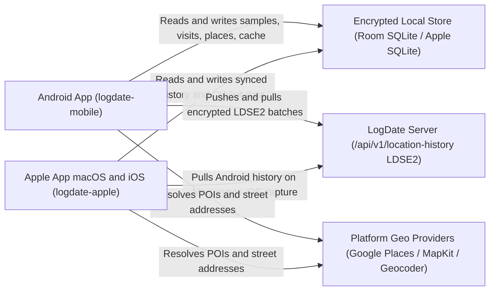

# Location Timeline v4 Plan: Capture Precision, Map UX, and Cross-Platform Rollout

This plan directs engineering leads and contributors executing `improve_timeline_ui_precision` across `logdate-mobile` and `logdate-apple`. Use it to sequence implementation strictly from Android proof-of-concept stabilization through macOS display and Apple-wide tracking, enforce exit gates between stages, and navigate to the governing specification for each subsystem.

LogDate already runs a real location-history foundation in `logdate-mobile` ([Human location history](../../implementation/human-location-history.md)) backed by Room schema 52, encrypted `LDSE2` server records at `/api/v1/location-history`, immutable corrections, and `LocationReplayTool`. That implementation currently loses activity context after ten minutes, drops saved places when two sit nearby, breaks travel timezones across trips, fails to attach memories at visit edges, and renders a bare marker-and-sheet UI. Fixing those failures on Android first creates clean, trustworthy data before any Apple or desktop client displays or records it.

## Strategic Sequencing and Stage Gates

Every stage below must clear its exit gate before engineers start the next stage. Do not implement Apple capture before macOS renders Android-synced data, and do not start macOS display until Android capture and reconstruction pass their accuracy and field-reliability gates.

| Stage | Scope | Primary Repo | Exit Gate | Specification |
| --- | --- | --- | --- | --- |
| 1A | Android sensor capture, geofence departure, stale-fix filter | `logdate-mobile` | Managed-device foreground/geofence tests and 24h stationary battery <= 3% field check pass | [01-android-capture-and-sensor-fidelity.md](./01-android-capture-and-sensor-fidelity.md) |
| 1B | Reconstruction v4, burst outlier rejection, kinematics, smoothing, timezones | `logdate-mobile` | Golden replay corpus passes target thresholds with zero regressions on real archives | [02-reconstruction-v4-and-accuracy-engine.md](./02-reconstruction-v4-and-accuracy-engine.md) |
| 1C | Unified place model, scored matching, persistent cache, Timeline integration | `logdate-mobile` | Room migration 52 -> 53, place disambiguation, and Timeline place tests pass | [03-place-identity-resolution-and-memory-linking.md](./03-place-identity-resolution-and-memory-linking.md) |
| 1D | Cartographic markers, clustering, mode polylines, dark style, continuous Replay | `logdate-mobile` | Managed-device Google Maps E2E and dark/light map screenshots pass visual inspection | [04-cartographic-map-and-replay-ux.md](./04-cartographic-map-and-replay-ux.md) |
| 1E | Sheet spring physics, date dots, redesigned cards, edit sheets, legacy removal | `logdate-mobile` | `checkHomeWorkspaceContract`, all populated screenshot scenes, and E2E suite pass | [05-timeline-sheet-navigation-and-editing-ux.md](./05-timeline-sheet-navigation-and-editing-ux.md) |
| 2 | macOS encrypted sync, SQLite storage, Swift Reconstruction v4, MapKit Places UI | `logdate-apple` | Swift vector suite passes 100% against v4 JSON vectors and loopback Android-to-Mac sync works | [08-macos-display-and-apple-tracking.md](./08-macos-display-and-apple-tracking.md) |
| 3 | iOS/iPadOS `CLVisit` + adaptive capture, motion activity, multi-device fusion | `logdate-apple` | Background visit capture, `LDSE2` upload, and two-device Android+iOS day fusion pass | [08-macos-display-and-apple-tracking.md](./08-macos-display-and-apple-tracking.md) |
| 4 | GNOME `libshumate` Places view; Web portal date timezone precision fixes | `logdate-linux`, `logdate-web` | Linux local storage foundation lands first; Web `formatRange` UTC shift defect resolved | [08-macos-display-and-apple-tracking.md](./08-macos-display-and-apple-tracking.md) |

## Verified Root-Cause Inventory

Auditing the current worktree uncovered twelve concrete defects causing missing stays, wrong place names, dropped travel modes, broken travel timezones, and unfinished map UX.

| ID | Code Location | Defect | User-Visible Failure | Spec |
| --- | --- | --- | --- | --- |
| RC-01 | `LocationHistoryService.kt:590-617` | `applyActivityEvidence` expires any `ENTER` transition after 10 minutes | Stays and drives longer than 10 minutes lose activity labels and revert to unknown | [02](./02-reconstruction-v4-and-accuracy-engine.md) |
| RC-02 | `LocationHistoryService.kt:265,378-382` | `.singleOrNull()` within fixed 75m drops matches; `UserPlaceEntity.radiusMeters` ignored | Two nearby shops leave visits unnamed; large parks or campuses split into multiple stops | [03](./03-place-identity-resolution-and-memory-linking.md) |
| RC-03 | `GooglePlacesExternalPlacesProvider.kt:27-87`, `ResolveLocationToPlaceUseCase.kt:49`, `HumanLocationHistoryViewModel.kt:442-472` | 250m `firstOrNull()` saves POI coordinates that fail the 75m snapshot filter on reload | Enriched place names vanish on the next reactive snapshot or label homes after nearby businesses | [03](./03-place-identity-resolution-and-memory-linking.md) |
| RC-04 | `PlaceResolutionCache.kt:33-68` | Unsynchronized insertion-order `linkedMapOf()`, `.toInt()` collapse at 0°, 24h error caching, volatile memory | Cache drops offline errors into 24h dark periods and thrashes under concurrent lookups | [03](./03-place-identity-resolution-and-memory-linking.md) |
| RC-05 | `LocationEvidenceQuality.kt:76-90`, `ReconstructLocationDay.kt:34-40,117-124`, `TravelModeInferenceProvider.kt:16-26` | Single-sample spike check; `isMock` accepted; no kinematic fallback; connectors carry empty routes | Multi-ping cell jumps split stays; unlabelled drives stay unknown; connectors disappear from map | [02](./02-reconstruction-v4-and-accuracy-engine.md) |
| RC-06 | `LocationHistoryService.kt:85-99`, `HumanHistoryMapper.kt:53-60`, `HumanLocationHistoryViewModel.kt:49` | `timeZoneId` stored per observation is ignored; ViewModel caches device zone once at init | Viewing travel days from another timezone splits stays across midnight and shifts visit hours | [02](./02-reconstruction-v4-and-accuracy-engine.md) |
| RC-07 | `AssociateVisitMemories.kt:26-33` | Exact `[start, end]` containment plus rigid 75m `.singleOrNull()` | Photos taken slightly outside indoor GPS centers or right at departure fail to link | [03](./03-place-identity-resolution-and-memory-linking.md) |
| RC-08 | `GetTimelineUseCase.kt:242-295` | `extractPlacesVisited` reads only note metadata and prints raw coordinates | Main Timeline displays decimal coordinates and misses recorded visits without notes | [03](./03-place-identity-resolution-and-memory-linking.md) |
| RC-09 | `ActivityAwareLocationService.kt:141-241`, `LocationProfile.kt:25-58`, `AndroidLocationEvidence.kt:10` | Starts in hot `ON_FOOT` profile; loses state on restart; `ON_BICYCLE` uses `IN_VEHICLE`; `waitForAccurateLocation(true)` stalls indoors; no exit geofence | Stationary cold starts drain battery; indoor waits create false gaps; departures lag up to 3m | [01](./01-android-capture-and-sensor-fidelity.md) |
| RC-10 | `NativeHistoryMap.android.kt:57-159`, `HumanPlacePicker.android.kt:34` | Stock default pins, no clustering, no dark style, gray lines for all modes, Las Vegas and Null Island fallbacks, journey zoom to first point | Map obscures day flow, fails dark-mode contrast, and zooms into one endpoint of a long trip | [04](./04-cartographic-map-and-replay-ux.md) |
| RC-11 | `WorkspaceSupportingSheet.kt:158-180`, `HistoryEditDialog.kt:111-153`, `HistoryPlaces.kt:124-137`, `HumanLocationHistoryScreen.kt:170` | Snap-only sheet drag; raw 24h text fields in `AlertDialog`; dead List/Map chips in Workspace; `"Device 1"` labels | Sheet feels unresponsive, editing requires typing raw times, and multi-device menus hide real names | [05](./05-timeline-sheet-navigation-and-editing-ux.md) |
| RC-12 | `LocationTimelineEntry.kt:26` vs `FeatureFlag.kt:60` | Flag defaults `true` while `collectAsStateWithLifecycle(false)` initializes `false` | Every cold launch of Places composes legacy UI and fires `captureLocationForTimelineReview()` | [05](./05-timeline-sheet-navigation-and-editing-ux.md) |

## System Container Architecture

This C4 container diagram shows the deployable clients, encrypted local stores, server collection, and platform lookup providers across the completed multi-stage rollout.

## Decision Register

Record these architectural decisions before editing code. Changing any one of them requires updating the affected specifications first.

1. **On-device route smoothing over external road-snapping APIs.** Journey polylines use an on-device velocity-gated Kalman smoother and Douglas-Peucker simplification (`5.0m` tolerance) rather than sending user GPS traces to Google Roads or OSRM. That keeps raw routes private and zero-cost offline. We would revisit this only if users request an explicit opt-in snap-to-roads action on individual trips.
2. **Android-first proof of concept over parallel client development.** Android capture, Reconstruction v4, and Compose UI ship and clear field battery and accuracy gates before macOS display or iOS capture work begins. Building Apple clients in parallel would force duplicate fixes across Kotlin and Swift while algorithms are still shifting.
3. **Unified `SemanticPlace` domain projection over table replacement.** Rather than migrating foreign keys across `places`, `user_places`, and `history_records` in one risky database rewrite, `LocationHistoryService` merges user places and synced places into one scored `SemanticPlace` catalog carrying `radiusMeters` and `category`. A single-table consolidation remains an isolated internal refactor for later.
4. **Single-device default per day with optional non-overlapping fusion.** Days default to the primary recording device so interleaved GPS jitter from a phone and tablet never creates zigzag lines, while an `"All devices"` option fills recording gaps exceeding `maximumGap` (`10 minutes`) from secondary devices with explicit device provenance.
5. **Honest `VEHICLE` labeling without guessed transit modes.** Kinematic classification distinguishes `WALKING`, `RUNNING`, `CYCLING`, and `VEHICLE` from GPS speed and stop cadence, reserving `BUS` and `TRAIN` for confirmed activity signals or user edits. Timetable or GTFS transit matching stays deferred because false train or bus labels damage user trust.

## Document Index

The eight companion documents in this directory specify each subsystem in detail.

| Document | Focus | Primary Reader |
| --- | --- | --- |
| [01-android-capture-and-sensor-fidelity.md](./01-android-capture-and-sensor-fidelity.md) | Adaptive profiles, geofence exit trigger, stale-fix rejection, battery targets, Wear boundary | Android location engineer |
| [02-reconstruction-v4-and-accuracy-engine.md](./02-reconstruction-v4-and-accuracy-engine.md) | State-interval activities, burst spike filter, adaptive stays, kinematics, smoothing, timezones | Domain algorithm engineer |
| [03-place-identity-resolution-and-memory-linking.md](./03-place-identity-resolution-and-memory-linking.md) | Place schema unification, scored matcher, POI filtering, persistent cache, Timeline unification | Domain and data engineer |
| [04-cartographic-map-and-replay-ux.md](./04-cartographic-map-and-replay-ux.md) | Custom markers, zoom clustering, mode polylines, dark style, camera states, animated Replay | Compose and Maps engineer |
| [05-timeline-sheet-navigation-and-editing-ux.md](./05-timeline-sheet-navigation-and-editing-ux.md) | Sheet spring physics, date dot strip, scannable cards, edit sheets, Places sort/detail, legacy cleanup | Compose workspace engineer |
| [06-data-models-migrations-and-sync-contracts.md](./06-data-models-migrations-and-sync-contracts.md) | Backward-compatible `LDSE2` additions, Room 52 -> 53 DDL, stager watermark, JSON test vectors | Storage, sync, and server engineer |
| [07-verification-benchmarks-and-rollout.md](./07-verification-benchmarks-and-rollout.md) | Golden benchmark corpus, numeric accuracy gates, Gradle/Managed Device checks, field battery protocol | Release and QA engineer |
| [08-macos-display-and-apple-tracking.md](./08-macos-display-and-apple-tracking.md) | Stage 2 macOS display, Stage 3 Apple capture (`CLVisit`), Stage 4 Linux and Web alignment | Apple, Linux, and Web engineers |
