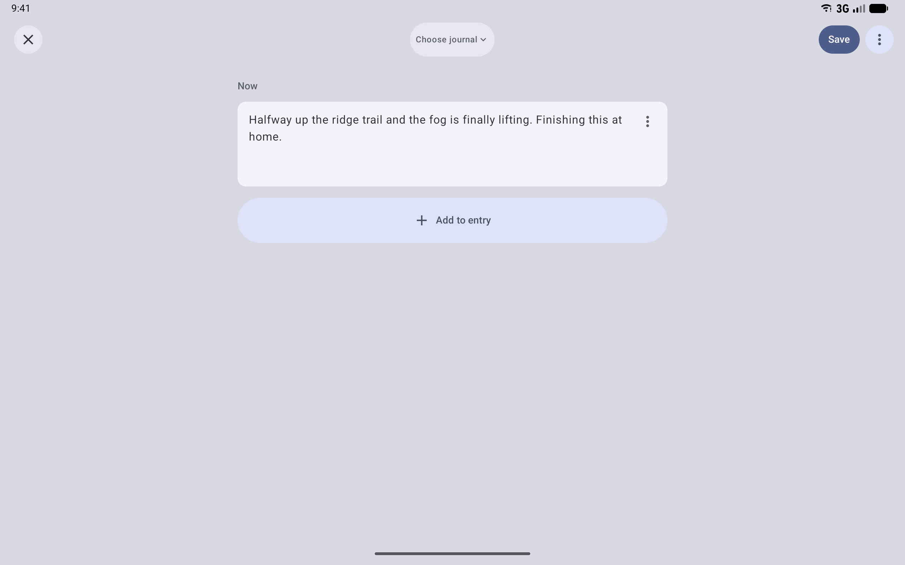
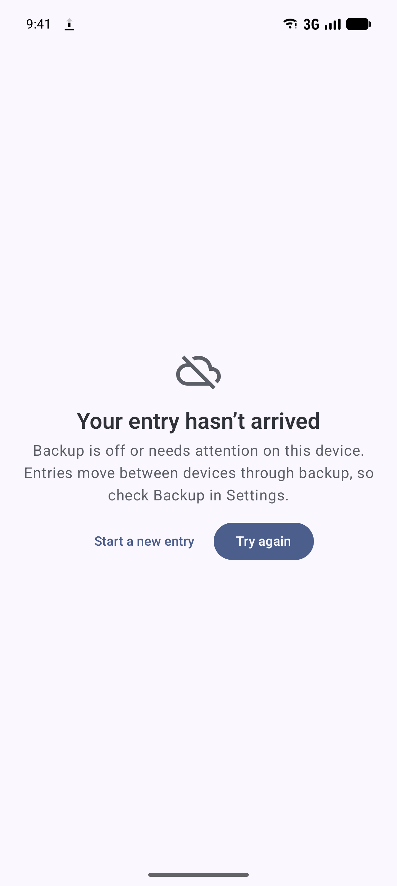

# AppFunctions

Status: built, behind `APP_FUNCTIONS` (Settings > Advanced > Developer tools > Feature previews), for
Android 16 (API 36) and later. Library: `androidx.appfunctions` 1.0.0-rc01.

## What it is

**AppFunctions** let an app offer actions to on-device agents and assistants, such as Gemini. An app
declares functions with typed parameters and results. Android registers them, and an agent can call
them on the person's behalf: "what did I write about the canal walk?" or "start a voice note in
LogDate".

AppFunctions are an Android platform API with a Jetpack library, `androidx.appfunctions`. They replace
the older App Actions `<capability>` bindings that `shortcuts.xml` used to carry.

## The rule assistants follow

An assistant never writes or changes a journal entry, not even as a suggestion the person could
accept. It can look at what the person chose to share, and it can open a new, empty entry that the
person then records or writes. Connected assistants follow the same rule, and both use one
permission model: `AssistantCapability` in `client/repository`.

## What the person can ask for

| Function            | What it does                                                          | Needs                                           |
| ------------------- | --------------------------------------------------------------------- | ----------------------------------------------- |
| `search(query)`     | Up to 10 matches, best first, each shortened to one line              | Entries, Places or People, and LogDate unlocked |
| `listJournals()`    | The journals whose entries the person shared, by id and title         | Entries, and LogDate unlocked                   |
| `startEntry(voice)` | A `PendingIntent` that opens a new voice note or written entry, empty | Start a voice note or entry                     |

`search` returns only kinds of content the person shared:

- **Entries.** Written entries and voice-note transcripts, but only from the journals the person
  picked. An entry that belongs to several journals counts only when every one of them is shared.
  Entries outside any journal need their own checkbox.
- **Places** and **People**, each with its own switch.

Rewinds, stickers, postcards, photo captions and ambient sounds are never returned, because no
permission covers them. Matches the person didn't share are dropped before the limit of 10, so an
assistant can't learn from a short result that more exists.

`startEntry` can't run in the background and open LogDate itself: Android doesn't let a background
call start an activity. Instead it returns a `PendingIntent`, and the assistant opens it while the
person is looking at it. The intent carries only the mode, never any text.

## Choosing what assistants can do

The person decides in **Settings › Privacy & security › Android assistants**. Everything starts off.
The page uses the same switches as the connected-assistant screens: Entries (with a journal picker),
Places, People, and Start a voice note or entry. The row in Privacy & security, and the page, appear
only on Android 16 and later while `APP_FUNCTIONS` is on. The Settings › Assistants list also shows
an "On this phone" entry for Android assistants when it is given one.

The choice is stored on this device (`DeviceAssistantAccessStore` in `client/domain`, kept in
`LogdatePreferencesDataSource`). It is separate from system search visibility, which only controls
whether entries appear in Android's own search.

## Refusals and the app lock

Every function says why it refused, in words the assistant can pass on:

- **Not shared.** The person hasn't turned on what the function needs. The message names the
  settings page where they can change it.
- **Locked.** Reading stops while LogDate is locked. If the app lock is on (`UserData.securityLevel`)
  and the person hasn't unlocked LogDate in this process, the call is refused. The setting is read
  directly, because the gatekeeper starts every new process as "no prompt needed", including one
  Android starts just to answer an assistant. `startEntry` ignores the lock: it reveals nothing, and
  LogDate's own lock screen still appears when the entry opens.
- **Unavailable.** LogDate couldn't open its journal, for example while a restore is finishing.

Refusals throw `AppFunctionDeniedException` (or `AppFunctionAppUnknownException` for Unavailable)
and never return partial data. The decisions live in `assistantReadRefusal`,
`assistantCaptureRefusal` and `assistantUnlocked` (app/compose-main commonMain,
`client/appfunctions/AssistantAccess.kt`), and which content counts is decided by
`AssistantSourceEligibility` and `DeviceAssistantLibrary` in `client/domain`.

## How it works

- `LogDateAppFunctions` (app/compose-main androidMain, `client/appfunctions/`) is an abstract
  `AppFunctionService` annotated `@AppFunctionServiceEntryPoint`. Each function carries
  `@AppFunctionDeclaration(isDescribedByKDoc = true)`, so its KDoc is the description agents read.
- Before it touches storage, every function waits for LogDate's startup
  (`ApplicationStartupCoordinator.start(application).awaitReady()`). Android may start LogDate's
  process just to answer an assistant, and that process hasn't opened the encrypted database yet.
- The AppFunctions KSP compiler, applied to the module's Android target as `kspAndroid`, generates the
  concrete `LogDateAppFunctionService` and the schema asset `logdate_app_functions.xml`. The
  multiplatform Android library does not package KSP assets on its own, so `app/compose-main`'s build
  adds that folder to its assets. Check that the APK contains `assets/logdate_app_functions.xml`.
- The app manifest declares the generated service with the `android.app.appfunctions.v2` property
  naming that asset, and an application-level `app_metadata` property pointing at
  `res/xml/app_functions_app_metadata.xml`. Its `instructions` attribute tells agents what LogDate is
  and how to use each function; `displayDescription` is what Android shows the person.

## Flag and rollout

`APP_FUNCTIONS`, off by default. The generated service is declared disabled and enabled by
`PlatformComponentToggler` while the flag is on, so Android only indexes the functions then.

Gemini calls an app's AppFunctions only after the app is registered in Google Connected Console as an
Android MCP connected app, linked to its Play app. Until the Play production release that carries the
functions is approved, only the connected app's testers can use them, and only with the exact app
bundle version that was submitted. The steps are in
[Create and manage Connected Apps](https://developer.android.com/ai/appfunctions/create-manage-connected-apps).

## Privacy

- No function writes or changes an entry. `startEntry` opens an empty entry; the person records or
  writes it and decides whether to save it.
- A public capture intent never carries text either. Other apps can open a new entry with
  `app.logdate.action.CAPTURE`, but it always starts empty; see the
  [capture launch contract](capture-launch-contract.md).
- Journal titles count as journal content, so `listJournals` follows the Entries permission.
- Search returns short excerpts rather than whole entries.

## How to test

- `AssistantSourceEligibilityTest`, `DeviceAssistantLibraryTest` and `DeviceAssistantAccessStoreTest`
  (`client/domain`) cover what each permission shares, the journal scope, the excluded content types,
  the limit and how the choice is stored.
- `AssistantAccessTest` (app/compose-main) covers refusals, the lock and excerpts.
  `CaptureTextIntentTest` checks that only LogDate's own route can start an entry with text.
- `AndroidAssistantsContentTest` and `AndroidAssistantsViewModelTest` (`client/feature/core`) cover
  the settings page.
- `OsSurfaceScreenshotsTest#assistantActions` drives the functions on an Android 16+ managed device
  the way an agent would. It checks that no write function is registered, that each function refuses
  until the person shares something, that reading stops while LogDate is locked, and that a shared
  entry is found. It saves the output as
  `docs/screenshots/android-os-integration/app-functions/assistant-actions--<device>-api37.txt`.
- By hand, on an emulator with the flag on and something shared:

  ```bash
  adb -s emulator-5554 shell cmd app_function list-app-functions
  ```

  ```bash
  adb -s emulator-5554 shell "cmd app_function execute-app-function --package studio.hypertext.logdate.debug --function 'app.logdate.client.appfunctions.LogDateAppFunctions#search' --parameters '{\"query\":[\"canal\"]}'"
  ```

  Each parameter is a one-element JSON array.

## Updating screenshots

`./run screenshots:os` records the text evidence under
`docs/screenshots/android-os-integration/app-functions/`.

## Cross-device: Handoff

Android 17 Handoff lets an activity continue on another of the person's Android devices. While an
activity is open, Android shows its app icon on the person's other nearby devices; picking it there
opens the same activity on that device. `MainActivity` opts in (`MainActivity+Handoff.kt`); the web
fallback stays off until logdate.app can rebuild app state from a URL.

### Editor Handoff

With `EDITOR_HANDOFF` on, an editor window can move too: start an entry on the phone, pick LogDate on
the tablet, and the tablet opens the same unfinished entry.

The hard part is that Handoff carries only a small bundle of extras, never the entry itself. The entry
travels as a **draft** through backup's draft sync (`DraftUploader` and `DraftDownloader` in
`client/sync`), which normally runs on backup's schedule. So the two devices each do one extra thing:

- **The sending device** (`EditorActivity.onHandoffActivityDataRequested`) puts the draft's id in the
  extras (`EntryEditorViewModel.draftIdForHandoff`). Text that autosave has not saved yet is handed
  off under the id its first draft is about to be saved with (`DraftManager.reserveDraftId`), and
  that save starts at once. Android also asks while the window is closing, for a copy it keeps, and
  this way that copy names the draft even if autosave is still running. When the request is active,
  meaning the person just picked LogDate on the other device, it also saves the latest text and runs
  draft sync at once, instead of waiting for backup's schedule. An empty editor hands off as a new
  entry.
- **The receiving device** opens `EditorActivity` with that id (`EXTRA_HANDOFF_DRAFT_ID`).
  `HandoffDraftGate` opens the draft at once when it is already on the device. Otherwise
  `HandoffDraftReceiver` runs draft sync every few seconds for up to a minute, through the
  `DraftRefresher` interface that `SyncDraftRefresher` implements, while the editor shows that the
  entry is on its way. If it never comes, the editor says why, with a different message for backup
  being off, a sync error (with its message), and a draft the other device has not uploaded. Try
  again starts the wait over, and Start a new entry stops waiting.

| Opened from another device                                                                                                                                                                 | When the draft has not arrived                                                                                                                                                                                                                              |
| ------------------------------------------------------------------------------------------------------------------------------------------------------------------------------------------ | ----------------------------------------------------------------------------------------------------------------------------------------------------------------------------------------------------------------------------------------------------------- |
|  |  |

The flag only controls whether an editor offers itself to other devices. An editor that a handoff
launches always opens its draft, so a device with the flag off can still receive one.

**Testing.** `HandoffDraftReceiverTest` and `HandoffDraftGateTest` (editor module) cover waiting,
arrival, each missing reason, Try again, and Start a new entry. `EditorHandoffTest` and
`SyncDraftRefresherTest` (compose-main) cover the handed-off id and how a draft sync result maps to
a reason, and `DraftManagementTest` checks that unsaved text is handed off under the id its draft is
then saved with. `OsSurfaceScreenshotsTest#editorHandoff` runs both ends on one Android 17 managed device: it
types an entry, checks that the editor offers Handoff and that the offered extras name its draft
(saved as `editor-handoff-data--<device>-api37.txt`), then launches the editor with those extras the
way Android does on a second device. A real two-device handoff needs two devices signed in to the
same Google account and LogDate account, which managed emulators cannot provide; that check is the
flag's remaining step before it turns on.
