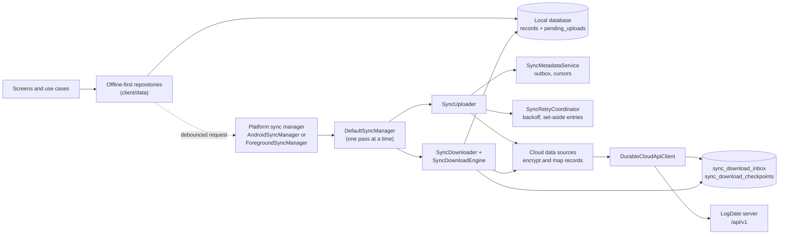
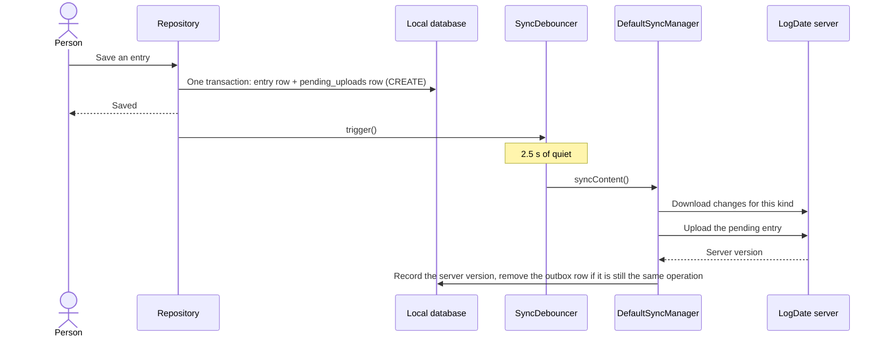
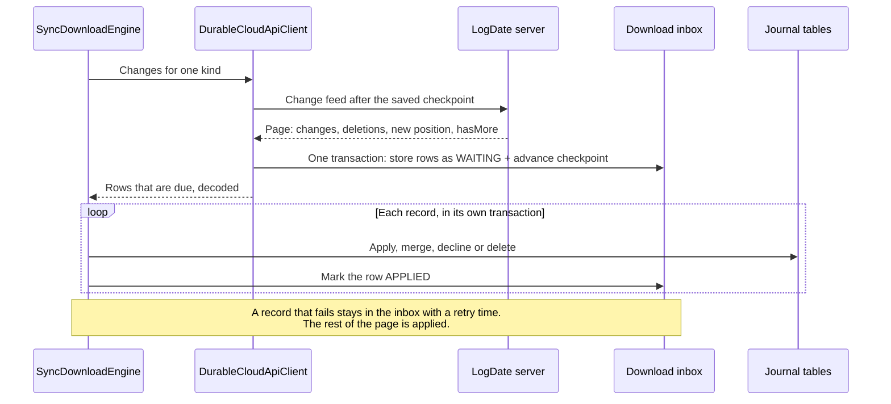
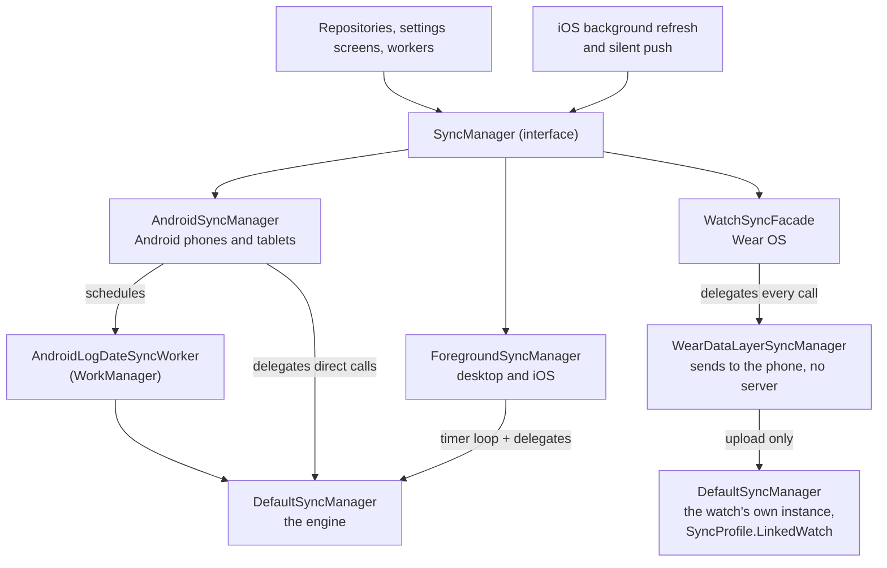

# Backup and sync architecture

This page describes how a LogDate app keeps a signed-in person's journals, entries, drafts and media
in step with a LogDate server and with their other devices. It covers the write path on the device,
the two durable queues that make sync restartable, how conflicts and deletions are settled, how
media travels, how much work one sync pass may do, which class schedules sync on each platform, and
the guarantees the design gives about data safety.

The app's settings call this feature "backup", because for most people its job is to make sure
nothing is lost with the device. In the code it is sync: the same engine uploads local changes and
downloads changes made elsewhere. Three neighbouring features are also called backup and are not
this engine. They are listed under [Other features called backup](#other-features-called-backup).

Related pages cover the parts this one only points to:

- [Sync V1 API](../../server/docs/sync-v1-api.md) and the interactive reference the server serves at
  `/docs` list every endpoint, parameter and error code.
- [Personal space sync](personal-space-sync.md) describes the transport used when an account's data
  lives in a sealed personal space.
- [Sync metrics and alerts](../observability/sync-metrics.md) and
  [Diagnosing backup and recovery safely](../observability/sync-diagnostics.md) cover what the
  server and the app record about sync.
- [The backup scheduling and notification model](../verification/backup-sync/README.md) is a
  bounded formal model of the scheduling contracts described here.

## Terms used on this page

**Local-first** means the device's own database is the source of truth for the app. Every screen
reads from it and every edit is written to it first; the network is never on the path of a save.

A **data repository** is a class on the device, in `client/data`, that features call to read and
write one kind of data. Where this page says "repository" without a qualifier it means one of these.

**Legacy storage** is one of the two places a server can keep an account's data. It is reached
through one set of endpoints per kind of data, such as `/api/v1/contents` for entries and
`/api/v1/journals` for journals. The other place is the sealed personal space; see
[Where the personal-space transport fits](#where-the-personal-space-transport-fits).

In legacy storage the server keeps all of one account's records in a single **account repository**.
That is a tree of content-addressed blocks with one **head**, the pointer to the tree's current
root. A write reads the tree, builds a new tree and replaces the head.
[Private storage in sealed personal spaces](../explanation/private-storage.md) describes that
structure and what it costs. Several ordering rules on this page exist because of it.

The **outbox** is the table of local changes that still have to reach the server. Each row names one
record and one operation: create, update or delete.

A **change feed** is a server endpoint that returns the records of one kind that changed after a
given position, a page at a time. The position is a **cursor**. A **tombstone** is the marker the
server keeps for a deleted record so that the deletion can travel through the change feed.

The **server version** is a number the server assigns to a record every time it accepts a write.
It is the server's clock reading in milliseconds, raised by one when two writes would otherwise
share a value, so it only ever grows. A device remembers the server version of each record it holds
as that record's `syncVersion`; zero means the record has never been uploaded.

A **scope** is the pair of account and server that a piece of sync state belongs to
(`UploadScope(ownerId, serverOrigin)` for uploads, `DownloadScope(owner, origin)` for downloads).
Every queue row, cursor and cached media reference carries its scope, because one installation can
sign in to different accounts and can be pointed at different servers.

The **download inbox** is the table where downloaded records are stored, still in the form they
arrived in, before they are applied to the journal.

A **pass** is one run of the engine through its download and upload phases. A pass is bounded: it
does a limited amount of work and then reports whether more is waiting.

An entry is **set aside** when it has used up its automatic retries. The code and the stored data
call the record of that a **dead letter**; the app lists it on the Sync issues screen.

## The parts and how they connect

Features never call the network. They call data repositories, which write to the local database and
to the outbox in the same transaction and then ask for a sync. A platform sync manager decides when
a sync actually runs and hands the work to one shared engine.

### Where the code lives

| Module or file                                                                                                                                                                                                              | What it holds                                                                                                                                                      |
| --------------------------------------------------------------------------------------------------------------------------------------------------------------------------------------------------------------------------- | ------------------------------------------------------------------------------------------------------------------------------------------------------------------ |
| [`client/data`](../../client/data/)                                                                                                                                                                                         | The offline-first repositories. They write a record and its outbox row together and request a debounced sync.                                                      |
| [`client/sync`](../../client/sync/)                                                                                                                                                                                         | The engine and everything it owns: uploaders, downloaders, the retry coordinator, conflict resolvers, media transfer, diagnostics, and the platform sync managers. |
| [`SyncManager.kt`](../../client/sync/src/commonMain/kotlin/app/logdate/client/sync/SyncManager.kt)                                                                                                                          | The `SyncManager` interface every caller uses, with `SyncResult`, `SyncStatus`, `SyncPausedReason` and `SyncError`.                                                |
| [`DefaultSyncManager.kt`](../../client/sync/src/commonMain/kotlin/app/logdate/client/sync/DefaultSyncManager.kt) and [`SyncRunPhases.kt`](../../client/sync/src/commonMain/kotlin/app/logdate/client/sync/SyncRunPhases.kt) | The engine: wiring, and the order of work inside a pass.                                                                                                           |
| [`metadata/`](../../client/sync/src/commonMain/kotlin/app/logdate/client/sync/metadata/)                                                                                                                                    | `SyncMetadataService` and its Room-backed `DatabaseSyncMetadataService`, the outbox model, the backoff ladder, the set-aside store and the media reference store.  |
| [`recovery/`](../../client/sync/src/commonMain/kotlin/app/logdate/client/sync/recovery/)                                                                                                                                    | `DownloadInbox`, `DurableCloudApiClient` and the media recovery that drains the inbox.                                                                             |
| [`conflict/`](../../client/sync/src/commonMain/kotlin/app/logdate/client/sync/conflict/)                                                                                                                                    | The resolvers, the conflict store and the recovery of edits to deleted items.                                                                                      |
| [`cloud/`](../../client/sync/src/commonMain/kotlin/app/logdate/client/sync/cloud/)                                                                                                                                          | The HTTP client, the per-kind data sources that encrypt and map records, and request binding.                                                                      |
| [`client/database`](../../client/database/src/commonMain/kotlin/app/logdate/client/database/entities/sync/)                                                                                                                 | The Room entities and DAOs for the sync tables.                                                                                                                    |
| [`shared/model`](../../shared/model/src/commonMain/kotlin/app/logdate/shared/model/sync/SyncModels.kt)                                                                                                                      | The request and response types the app and the server share, including `VersionConstraint`.                                                                        |
| [`server`](../../server/src/main/kotlin/app/logdate/server/routes/sync/)                                                                                                                                                    | The sync routes, and the maintenance loop that purges old tombstones.                                                                                              |

## What a save does before any network call

A save has to succeed with no connection, no account and no server, so the write path never waits
for any of them. Creating an entry runs one database transaction that inserts the entry, indexes its
media when it has any, and inserts an outbox row with the operation `CREATE`
(`OfflineFirstJournalNotesRepository.create` in
[`client/data`](../../client/data/src/commonMain/kotlin/app/logdate/client/data/notes/OfflineFirstJournalNotesRepository.kt)).
Edits, deletions and changes to which journal an entry belongs to follow the same pattern. Because
the record and its outbox row commit together, there is no moment at which a saved change exists
without the note that it still has to upload, and no moment at which the outbox names a change that
was rolled back.

The outbox is written whether or not anyone is signed in. `DatabaseSyncMetadataService` treats a
missing session as a paused transport and never as a reason to drop or skip the row, so work done
offline or before sign-in is still queued when sync becomes possible.

After the transaction commits, the repository calls `SyncDebouncer.trigger()`. The debouncer waits
for 2.5 seconds of quiet (`SyncDebouncer.DEFAULT_WINDOW`) and then asks the sync manager for a sync
of that kind of data. Without the wait, every save in a burst of editing would start its own sync,
each one queued behind the last on the engine's lock. A failed debounced sync is logged and dropped,
which is safe because the outbox row is the durable record of what remains to upload.

## The outbox of pending uploads

The outbox is the Room table `pending_uploads`
([`PendingUploadEntity`](../../client/database/src/commonMain/kotlin/app/logdate/client/database/entities/sync/PendingUploadEntity.kt)).
Its primary key is `(ownerId, serverOrigin, entityType, entityId)`, so there is at most one row per
record per scope. The other columns are `operation`, `createdAt`, `retryCount`,
`expectedServerVersion` and `operationId`.

`entityType` is one of the names in `EntityType`
([`SyncMetadataService.kt`](../../client/sync/src/commonMain/kotlin/app/logdate/client/sync/metadata/SyncMetadataService.kt)).
The kinds that are queued are `JOURNAL`, `JOURNAL_MERGE`, `NOTE`, `ASSOCIATION` (an entry's
membership of a journal), `DRAFT`, `MOMENT` (a moment marked on the watch), and six location-history
kinds that are queued only when the account's data is in a personal space: `PLACE`, `PLACE_VISIT`,
`PLACE_CORRECTION`, `PLACE_ENTRY_LINK`, `PLACE_JOURNEY` and `LOCATION_SAMPLES`. The enum has two
more names, `MEDIA` and `HEALTH`. Each labels a last-sync time and neither is ever written to the
outbox; media travels with the entry, journal or draft that owns it. A row whose type this build
does not recognise, such as one written by a newer version, is kept and counted rather than deleted.

### Several changes to one record become one row

Because the key allows one row per record, a new change to a record that is already queued replaces
the row. `PendingOperation.coalesce` decides the resulting operation:

| Already queued       | New change | Row becomes    | Why                                                                                                                |
| -------------------- | ---------- | -------------- | ------------------------------------------------------------------------------------------------------------------ |
| nothing              | any        | the new change | First change to this record.                                                                                       |
| any                  | `DELETE`   | `DELETE`       | A deletion always stays queued. The create it follows may already be in flight, so the server may hold the record. |
| any                  | `CREATE`   | `CREATE`       | The record is being made again.                                                                                    |
| `CREATE` or `DELETE` | `UPDATE`   | `CREATE`       | The server does not hold a live copy, so the edit has to go up as a create.                                        |
| `UPDATE`             | `UPDATE`   | `UPDATE`       | Only the latest content is uploaded.                                                                               |

The row keeps the `createdAt` of the first change, so the queue stays in the order the records were
first touched.

### Each queued change has its own identity

Every write to the outbox gives the row a new random `operationId`. An upload captures the row,
including that ID, before it suspends on the network. When the response comes back, the row is
removed only if it still carries the captured ID (`SyncMetadataService.settleIfCurrent`, backed by
`SyncMetadataDao.deletePendingIfCurrent`, which reads and deletes in one transaction). If the person
edited the record again while the upload was in flight, the row now has a different ID, the late
response removes nothing, and the newer edit uploads on the next pass. The same check guards the
retry counter (`incrementRetryIfCurrent`) and every other place that changes a row after a suspend
point. Without this, a slow response for an old edit could mark a newer edit as uploaded and the
newer edit would never leave the device.

`expectedServerVersion` records the server version a queued repair is based on. An update sent to
the server carries the version the device last saw, and the server refuses the write when its own
version differs, so a retry is a compare-and-set rather than a blind overwrite. After a successful
upload the engine first advances the surviving row's expected version
(`advancePendingVersionAfterUpload`) and only then updates the record, so a restart between the two
steps cannot replay an older base version.

### Retry state

Retry state is held in two places. The number of failed attempts is the `retryCount` column on the
outbox row. The time of the next attempt, and the marker for an attempt that started and has not
finished, are kept outside the row in `SyncRetryScheduleStore`, keyed by the queued operation, so a
newer change to the same record starts with a clean schedule. In the engine,
[`SyncRetryCoordinator`](../../client/sync/src/commonMain/kotlin/app/logdate/client/sync/SyncRetryCoordinator.kt)
is the only class that changes either.

When an upload fails, the retry count goes up by one and the next attempt is scheduled from the
ladder in
[`SyncBackoff`](../../client/sync/src/commonMain/kotlin/app/logdate/client/sync/metadata/SyncBackoff.kt):

| Attempt | 1   | 2   | 3   | 4   | 5    | 6    | 7     | 8      | 9 and later |
| ------- | --- | --- | --- | --- | ---- | ---- | ----- | ------ | ----------- |
| Delay   | 1 s | 2 s | 4 s | 8 s | 16 s | 30 s | 5 min | 30 min | 1 h         |

Each delay is varied by up to 20 percent in either direction so devices that went offline together
do not all return at the same instant. When the server sends `Retry-After`, the longer of the two
waits is used. An entry inside its wait is skipped by the upload pass without being loaded.

An entry is set aside when its retry count reaches 9 (`SyncRetryPolicy.MAX_RETRY_ATTEMPTS`), or at
once when the failure can never succeed on retry: media over the upload limit, media that was
missing on two attempts in a row, an outbox row whose ID cannot be parsed, or a row whose local
record no longer exists. A single missing-media result is not treated as permanent, because a
storage provider that merely failed to answer looks the same as a file that is gone.

A set-aside entry **stays in the outbox**. Removing it would make every count the person can see
report the entry as synced when it never reached the server. Its record in `SyncDeadLetterStore`
carries a reason, and the reason decides what happens next:

- Reasons that describe a temporary condition (`NETWORK_UNAVAILABLE`, `SERVER_UNAVAILABLE`,
  `SIGN_IN_REQUIRED`) are tried again automatically after 24 hours
  (`SyncRetryPolicy.DEAD_LETTER_RETRY_INTERVAL_MS`), and sooner when connectivity returns or the
  person asks for a backup.
- Every other reason waits for the person. Sync issues offers a retry, which clears the schedule and
  makes the entry due, and the engine's `discardDeadLetter` removes the change for good.
- On Android, the first worker run after an app update reconsiders every set-aside entry once per
  account and server (`SyncUpgradeResumption`), because a fix in the new build may be what the
  entry was waiting for.

### An upload that takes the app down with it

An upload that crashes the app never reaches the failure handler, so its retry count would never
rise and it would be first in the queue, and crash the app again, on every launch. To break that
loop the coordinator records that an attempt is starting before it does anything risky
(`beginUpload`). If the app comes back and finds an attempt that never finished, it tries once more;
a second unfinished attempt in a row (`MAX_UNFINISHED_ATTEMPTS = 2`) sets the entry aside with the
reason `APP_CLOSED`. A pass that is cancelled or fails cleanly lets go of the attempts it started
(`abandonAttemptsInFlight`), so only a real process death counts.

## How one sync pass runs

`DefaultSyncManager` does all the work but schedules none of it. It holds one mutex (`syncMutex`),
and every entry point takes it, so two passes never run at once on a device. That matters for
correctness and not only for tidiness. In legacy storage every write goes into the one account
repository, and each write reads the tree, builds a new one and replaces the head. Two writes in
flight at once each build a tree that lacks the other's record, the later head replaces the earlier
one, and the earlier record is no longer reachable.

A full pass (`fullSync`, implemented by `runCompleteSync`) does these steps in order:

1. Capture the account and server the pass is for (`FullSyncScope`). Every later step checks that
   they have not changed and stops the pass if they have.
2. Read the account from the server (`/auth/me`) so the account's storage mode is the server's
   current answer. This decides whether the pass talks to the per-kind endpoints or to the personal
   space; see [Where the personal-space transport fits](#where-the-personal-space-transport-fits).
3. Adjust the device to the store the account is in (`prepareRouteForSync`). If the app stopped
   part-way through switching a journal back to legacy storage, that switch is finished first. Then,
   if the account has moved between legacy storage and its personal space since this device last
   synced it, the server versions recorded on entries and journals are reset to zero
   (`rebaseForRoute`). The two stores number versions differently, so a version kept from the other
   store would make every incoming change look older than the local copy and the change would be
   skipped. The pass stops here if this step fails, and the step is skipped when step 2 could not
   read the account. The [journal moves reference](journal-moves.md) covers the switch itself.
4. On the first sync with a server, queue every journal and entry already on the device as a
   `CREATE` (`FirstSyncEnqueuer`), skipping anything that already has a queued change.
5. **Download.** Journals, then entries, then journal memberships, then location history, then
   marked moments. After that, recover media for the entries and journals that were applied.
6. **Upload.** Journals, then entries, then journal merges, then journal memberships, then drafts,
   then location history, then marked moments. Journal merges are sent only when the journal and
   entry uploads of the same pass both succeeded, so a merge is never sent while a journal or entry
   it concerns is still waiting.
7. Sync drafts in both directions.
8. Register the device with the account if it is not registered yet.
9. If the pass succeeded and nothing is left pending, let a due move of the journal into its
   personal space run; the [journal moves reference](journal-moves.md) covers that.

Download comes before upload so that an upload the server refuses as a conflict already has the
other device's version on hand to compare with. The kinds are processed one after another in both
directions, never in parallel, for the same account-repository reason as the mutex.

Each phase checks the same gates before it starts: sync is enabled, a session exists, the account's
storage mode is one this device can sync, and the device has an encryption identity key. A device
without a key whose account already has data on the server stops with the paused reason
`NEEDS_RECOVERY_PHRASE` instead of creating a new key, because a new key could never read what is
already there.

Some failures are about the device rather than about one record: the identity key is missing, or
local storage is full or cannot be opened. `SyncReadinessGate` recognises these, stops the pass, and
does not charge the failure to any record's retry budget. It then allows one probe after a delay
that starts at 1 second and doubles up to 60 seconds; a manual backup probes at once.

Besides the full pass there are four narrower entry points, `syncContent`, `syncJournals`,
`syncAssociations` and `syncDrafts`. Each downloads and then uploads one kind of data. The
repositories' debounced requests use these, so saving an entry does not walk every kind.

### Limits on the work in one pass

Sync runs inside operating-system background budgets and against a server whose cost per request
grows with the size of the journal, so every loop has a ceiling. Work that does not fit is left in
the outbox or the inbox, and `SyncResult.hasMorePending` tells the caller that another pass is
needed. That flag is progress, not an error.

| Limit                                                                                                        | Value                                           | Where                                                              |
| ------------------------------------------------------------------------------------------------------------ | ----------------------------------------------- | ------------------------------------------------------------------ |
| Journals or entries the app requests per change-feed page                                                    | 25                                              | `SyncDownloader.SYNC_PAGE_SIZE`                                    |
| Server page size for entries, journals, memberships and moments when the request names none, and the maximum | 200, 500                                        | `DEFAULT_SYNC_PAGE_SIZE`, `MAX_SYNC_PAGE_SIZE` in `SyncHelpers.kt` |
| Server page size for drafts when the request names none (a requested size is not capped)                     | 100                                             | `DRAFT_SYNC_PAGE_SIZE`                                             |
| Inbox rows read per kind per page                                                                            | 100                                             | `DownloadInboxDao.pending`                                         |
| Passes in a row while each succeeds and makes progress, and the pause between them                           | until nothing is due or a pass fails, 1 s apart | `SyncPassLoop`                                                     |
| Passes in a row that move nothing before the loop gives up                                                   | 3                                               | `SyncPassLoop.MAX_STALLED_PASSES`                                  |
| Passes inside one Android worker run                                                                         | 8                                               | `runSyncBatches` in `SyncBatchRunner.kt`                           |
| Android worker runs before the work is reported finished or failed                                           | 6                                               | `SyncWorkerRetryPolicy.MAX_ATTEMPTS`                               |
| Largest media file the app will upload                                                                       | 31 MiB                                          | `MAX_MEDIA_UPLOAD_BYTES` in `CloudMediaDataSource.kt`              |

The page size of 25 is deliberately small. The server reads each record out of the account
repository, and a page of 200 stopped finishing inside the request timeout once an account held a
few hundred entries; a download that times out fails the whole sync.

## The download inbox

Applying a downloaded record can fail for reasons that have nothing to do with the network: the
record is encrypted with a key the device does not have yet, it was written by a newer version of
the app, or the local database refuses the write. If the download position had already moved past
such a record, it would be lost to this device. The inbox removes that risk by separating "the
server sent it" from "the journal has it".

[`DurableCloudApiClient`](../../client/sync/src/commonMain/kotlin/app/logdate/client/sync/recovery/DurableCloudApiClient.kt)
wraps the HTTP client for every change feed. When a page arrives it stores each record and each
deletion in `sync_download_inbox`, exactly as received, and advances the position for that kind in
`sync_download_checkpoints`, in **one transaction**. Only then does it hand records to the engine,
and what it hands over is the set of due rows read back from the inbox, not the network response.
A fetch that fails while rows are waiting still lets the engine work through those rows, except
that a refused sign-in is always reported so the session can be refreshed.

Each inbox row
([`DownloadInboxEntity`](../../client/database/src/commonMain/kotlin/app/logdate/client/database/entities/sync/DownloadInboxEntity.kt))
is keyed by `(ownerId, serverOrigin, entityType, entityId)` and holds the record's server
`version`, whether it is a deletion, the `payload` as received, an `operationId` for diagnostics,
and its retry state: `state`, `attempts`, `nextAttemptAt` and `reason`.

| State     | Meaning                                                                                                                     |
| --------- | --------------------------------------------------------------------------------------------------------------------------- |
| `WAITING` | Stored, not applied yet. Applied on the next pass once due.                                                                 |
| `FAILED`  | An attempt failed. Tried again once `nextAttemptAt` passes.                                                                 |
| `PARKED`  | Nine attempts failed (`DownloadInbox.MAX_ATTEMPTS`). Still counted as backlog, but no pass and no manual backup retries it. |
| `APPLIED` | Done. The row stays as a record of the version this device has applied.                                                     |

A failed row waits 2 seconds after its first failure and twice as long after each further one, up
to one hour. Two reasons are treated specially. A row held back only by the data-usage policy
(`NETWORK_POLICY`) is checked again after 30 seconds and the wait does not count as an attempt. A
row this build cannot read because a newer version wrote it (`UNSUPPORTED_FORMAT`) is never parked:
only an app update can read it, so it is kept and offered again without ever blocking the rest of
the sync.

Three properties follow from keeping applied rows:

- **A record is applied at most once per version.** Staging skips a record when the inbox already
  holds the same or a newer version of it, so a page that is fetched twice, or a checkpoint that is
  moved back, does not reapply anything.
- **Applied content is trimmed.** Marking a row applied empties its payload. Two kinds keep a
  reduced payload instead: a draft row drops its text, block types and journal list and keeps the
  rest, which media recovery reads, and a personal-space row keeps which record it was without its
  content, so a later deletion of that record can still be matched.
- **Recovering a key reopens parked work.** After the encryption identity is recovered,
  `DownloadInbox.release(afterRecovery = true)` returns every waiting, failed and parked row to
  `WAITING` with its attempts reset.

The table `sync_cursors` holds one timestamp per kind and scope, updated as pages are processed, and
is what the status screen shows as the last sync time. Every shipped app wires the inbox in, so the
checkpoint is the fetch position; the engine falls back to `sync_cursors` for that only when it is constructed without an inbox, as some
tests do.

## How a downloaded record is applied

[`SyncDownloadEngine`](../../client/sync/src/commonMain/kotlin/app/logdate/client/sync/SyncDownloadEngine.kt)
applies journals and entries. It handles each record in its own database transaction, so one record
that fails rolls back alone and is reported to the inbox while the rest of the page commits. For
each record it takes the first rule that matches:

| Situation on the device                                                                                    | What happens                                                                                                                                                                                                           |
| ---------------------------------------------------------------------------------------------------------- | ---------------------------------------------------------------------------------------------------------------------------------------------------------------------------------------------------------------------- |
| The record is here with a queued upload, and the server's copy already matches what that upload would send | The queued upload is settled without sending anything. This recovers from an upload whose response was lost.                                                                                                           |
| The record is not here, but a change to it is queued                                                       | Declined. The queued change is uploaded and settled on its own terms.                                                                                                                                                  |
| The record is not here and the device's profile does not keep it (`RemoteApplyFilter`)                     | Declined. Only the linked-watch profile sets a filter, and a linked watch is not asked to download, so no shipped app reaches this rule.                                                                               |
| The record is here, its `syncVersion` is above zero, and it is the same as or newer than the server's      | Declined; the device already has this version. A local copy whose `syncVersion` is zero never takes this rule, because zero means no server version is recorded for it.                                                |
| The record is here with a queued change, and the previous rule did not match                               | The local copy is kept, the remote copy is not applied, and a conflict is recorded for review.                                                                                                                         |
| The record is here with nothing queued, and the account's data is in a personal space                      | The server's copy replaces the local one and no resolver is asked. The personal space offers only changes made since this device last applied the record, so with nothing changed locally there is nothing to resolve. |
| The record is here with nothing queued, and the account's data is in legacy storage                        | The kind's conflict resolver decides; see the next section.                                                                                                                                                            |
| The record is not here and nothing is queued                                                               | Created locally.                                                                                                                                                                                                       |

Journal memberships and drafts do not fit this table and have their own downloaders
(`AssociationDownloader`, `DraftDownloader`). A membership has no content to merge: an addition or a
removal is applied unless the same link has a change queued locally, in which case a conflict is
recorded. For drafts, see [Drafts](#drafts).

## Conflicts

A conflict is two devices changing the same record without having seen each other's change. It is
found in one of two places.

**On upload.** An update carries a `VersionConstraint.Known` holding the server version the device
last saw. When the server's current version differs, it answers `409 CONFLICT` and changes nothing.
The app does not retry the write, because it would be refused again; it records a conflict, settles
the outbox row, and leaves the local copy as it is (`SyncRetryCoordinator.handleUploadConflict`).
The server's copy is not fetched at that point, so the record of an upload conflict holds the local
version number and time and nothing of the other version.

**On download.** When a server copy arrives for a record that has a queued change, the engine keeps
the local copy and records a conflict without asking anything. When one arrives for a record with
nothing queued, and the account's data is in legacy storage, the engine asks the kind's
`ConflictResolver`, which returns one of four outcomes:

| Outcome                    | Effect                                                                                                           |
| -------------------------- | ---------------------------------------------------------------------------------------------------------------- |
| `KeepRemote`               | The server's copy replaces the local one.                                                                        |
| `KeepLocal`                | The local copy is kept and queued as an update, so the server converges on it.                                   |
| `Merge`                    | The merged record is saved locally and queued as an update.                                                      |
| `RequiresManualResolution` | Neither copy is changed and a conflict is recorded. For a text or audio entry the record includes both versions. |

`JournalConflictResolver` merges where it safely can. An empty title or description takes the other
copy's value, a journal favorited on either device stays favorited, the earlier creation time wins,
and the merged journal is uploaded. Two different non-empty titles, or two different non-empty
descriptions, require review.

`JournalNoteConflictResolver` never merges the body of an entry. It compares the fields that make up
each type of entry, and when they all match it resolves to the server's copy:

| Entry type      | Fields compared                                         |
| --------------- | ------------------------------------------------------- |
| Text            | Text and location                                       |
| Photo and video | Media reference and location                            |
| Audio           | Media reference, duration, caption and location         |
| Handwriting     | The drawing, its unreadable-content marker and location |

Any difference in those fields, or a change of entry type, requires review. In every outcome the
resolver copies the facts recorded once at capture time (time zone, capturing device, capture
activity) from whichever copy has them, so a copy written by an older app version cannot erase them.

`LastWriteWinsResolver`, in
[`ConflictResolver.kt`](../../client/sync/src/commonMain/kotlin/app/logdate/client/sync/conflict/ConflictResolver.kt),
compares the two timestamps and keeps the local copy on a tie. Journals and entries do not use it.
The personal-space transport uses it for drafts.

Marked moments do not go through a `ConflictResolver`. `MarkedMomentConflictResolver` always merges
two copies of the same moment, so a moment never needs review. Its state only moves forward, the
entries a moment was turned into are the union of both copies, and the remaining fields come from
the copy that was updated later. Ties are broken by comparing field values, so two devices reach the
same result whichever copy each one saw first.

Recorded conflicts go to `SyncConflictStore`. How much a record holds depends on what conflicted:

- A conflict between two text entries or two audio entries, found on download, stores both complete
  versions (`TextConflictVersions`, `AudioConflictVersions`) outside the journal's own tables, so
  neither device's writing is lost while it waits. Sync issues shows both versions but does not
  resolve them: no control picks one, merges them or uploads the result, so the devices stay
  different until the person edits the record. The only resolving action in Sync issues is **Save as
  a new item**, for edits of deleted items.
- Every other conflict stores the record's kind and ID, the version numbers and times that were
  known, and a reason, with no copy of either version. That covers journals, photo, video and
  handwriting entries, journal memberships, drafts, and every conflict found when an upload is
  refused with `409 CONFLICT`. The device still holds its own copy in the journal and the server
  still holds the other. Sync issues counts these separately (`SyncStatus.earlierConflictCount`)
  and has nothing to compare.

## Deletions

Deleting a record on a device writes a `DELETE` row to the outbox, and the server keeps a tombstone
when it accepts the deletion. Other devices receive the tombstone through the change feed and
delete their copy.

A deletion must never destroy work the person has not finished syncing. When a tombstone arrives,
`decideRemoteDeletion` in
[`SyncDownloadDeletionApplier.kt`](../../client/sync/src/commonMain/kotlin/app/logdate/client/sync/SyncDownloadDeletionApplier.kt)
looks at the local copy. The copy is treated as unsent work when any of these is true:

- a create or update for it is queued;
- a change to one of its journal memberships is queued;
- its `syncVersion` is newer than the tombstone's version.

When there is unsent work, `DeletionConflictRecovery` first saves a complete snapshot of it in the
conflict store: the entry or journal, the journals it belonged to, and a reference to an app-owned
copy of its media file. The queued uploads for it are settled, since the server would refuse them.
Then the deletion is applied. The person finds the snapshot in Sync issues and can choose **Save as
a new item**, which restores it under a new identity and leaves the original deleted. When there is
no unsent work the record is simply deleted, and a queued local `DELETE` for it is settled because
both devices agree.

The server enforces the same rule from its side. An upload that targets a record with a tombstone is
answered `409 DELETION_CONFLICT`, and the app handles that answer exactly as above: the edit is
saved for review and the upload is settled.

Tombstones are not kept for ever. A maintenance loop on the server purges tombstones older than
`SYNC_TOMBSTONE_RETENTION_DAYS` (30 by default); it runs every
`SYNC_TOMBSTONE_PURGE_INTERVAL_MINUTES` (60 by default) unless `SYNC_TOMBSTONE_PURGE_ENABLED` is
`false`. The [Sync V1 API](../../server/docs/sync-v1-api.md) page documents the operator endpoint
that runs a purge on demand.

Every server instance starts this loop, but only one at a time runs a pass. Before a pass, an
instance takes a lease that all instances sharing the database respect: a PostgreSQL advisory lock
held for as long as the pass runs. An instance that finds the lease taken skips that pass, and one
that stops in the middle of a pass frees the lease with its database session. Each instance also
waits a random moment of up to five minutes before its first pass, so instances that start together
don't all reach for the lease at once. When the lease can't be checked, the instance skips the pass
and production logs record `SERVER_MAINTENANCE_LEASE_FAILED`.

On the per-kind endpoints, a device that stays offline longer than the retention period never
receives the deletions purged in the meantime, and the change feed gives no signal that its cursor is
older than the purge cutoff. The personal-space transport detects this case and lists the whole
space again.

## Media transfer

Photos, video and audio are files, and they are far larger than the records that refer to them, so
they travel separately from the records and under their own rules.

**Upload.** Before an entry uploads, `NoteMediaUpload.prepare` uploads its media file and rewrites
the entry's media reference to the server's. The entry is not sent until that succeeds, so the
server never holds an entry that points at a file it does not have. The file is encrypted on the
device as it is read, in the chunked `LDCE2` format, so neither the app nor the server holds more
than one chunk in memory; [Encryption formats](encryption-formats.md) specifies the layout. Files
in the single-operation `LDCE1` format are also read.

The key that encrypts media is derived on the device from its identity key
(`MediaPayloadKeyProvider`) and held in the platform's secure storage, so the recovery phrase
reproduces it on another device. The server is never given that key in a form it can read; it
stores and returns the encrypted bytes and nothing else. Every chunk is authenticated together with
its position in the file, so a chunk that was altered, moved or cut off fails to decrypt on download
instead of being saved as a damaged photo or recording. [Encryption](../explanation/encryption.md)
covers the key hierarchy and how keys reach a second device. Where the server keeps the encrypted
bytes, a storage bucket or a directory, is a deployment setting; see Media Storage in
[the server's environment variables](../../server/docs/environment-variables.md).

**Not uploading the same bytes twice.** Before sending a file the app saves an upload intent: a
random ID bound to the account, the server, the file's content and the key it is encrypted with
(`MediaUploadIntentStore`). A retry first asks the server for the receipt of that intent. If the
earlier attempt had in fact committed and only its response was lost, the receipt supplies the
result and no bytes are sent again.

**Remembering where a file lives.** `MediaSyncRefStore` maps a local file to its server copy so the
file is not uploaded again. Each mapping is tied to the account and server it was made for and
answers only for them. Reusing a mapping made against another server would point this server at a
file that disappears with the other one.

**Network policy.** The app sorts the current connection into three modes (`DataUsageMode`). On an
unmetered connection everything syncs. On a metered connection, records sync and media waits. With
the system's data saver on, or with no connection, the foreground scheduler skips its cycles.
While media is waiting the status carries the paused reason `MEDIA_WAITING_FOR_WIFI`, and it is
reported only once something has actually been held back. A person can allow media over mobile data
for one backup request (`requestBackup(allowMeteredMedia = true)`); that consent is bound to the
account and server of that request and does not change the policy.

**Download.** A downloaded entry is applied first, with its text and metadata, and its media is
fetched afterwards. When an applied entry's media reference is still a server URL, the inbox gains a
separate row for it (`MEDIA_NOTE`, and likewise `MEDIA_DRAFT` and `MEDIA_JOURNAL` for draft
attachments and journal covers). `SyncMediaRecovery` drains those rows with the same retry and
parking rules as any inbox row. A media row is settled only when the bytes are on the device and the
entry has been pointed at the local file, or when the entry no longer refers to that media; a
reference to a server URL is never counted as recovered. A media failure therefore delays one file
and nothing else.

## Drafts

A draft is an entry still being written. Drafts sync so that writing started on one device can be
finished on another.

When the server advertises the protocol feature `richDraftsV1`, a draft's blocks (text, photos,
audio, video and handwriting) are uploaded as one encrypted value, and its media is uploaded first
in the same way as an entry's. A client that predates rich drafts cannot overwrite such a draft with
text only: the server answers `409 DRAFT_FORMAT_UPGRADE_REQUIRED`, so an older app cannot silently
drop the blocks it does not understand. Drafts that were already on a device when rich drafts
became available are queued once per account and server (`DraftUploader.enqueueForRichSync`).

A downloaded draft is applied unless a local change to it is queued, in which case the local draft
is kept and a conflict is recorded. With nothing queued, a local draft that was modified later than
the downloaded one is kept and queued for upload; otherwise the downloaded draft replaces it. A
queued draft upload whose response was lost is settled only when the downloaded draft is identical
to the local one after decryption, never on a matching ID or timestamp alone.

## Requests are bound to an account and a server

A device can sign out, sign in as someone else, or be pointed at a different server while a request
is in flight. If the response were then saved, one account's data could be written into another's
journal, or one server's version numbers recorded against another server.

Every request therefore captures the server address and the session together before its first
suspend point (`CloudRequestBinding`), and the binding is checked again when the response arrives
and around every token refresh. A mismatch fails the request with the client-side error code
`CLOUD_SCOPE_CHANGED`, and nothing from the response is saved. Outbox rows, inbox rows, cursors,
conflicts and media mappings all carry their scope, and the code that settles them compares the
captured scope with the current one first. A full pass that notices its account or server has
changed stops and reports more work pending, so the next pass starts cleanly for the new scope.

The same rule covers what a server says about itself. The list of protocol features a server
advertises, which switches behaviour such as rich drafts on, is kept only when it names the server
the app is currently pointed at (`updateServerDescriptor` in
[`LogDateConfigRepository.kt`](../../shared/config/src/commonMain/kotlin/app/logdate/shared/config/LogDateConfigRepository.kt)),
so a slow answer from a previous server cannot switch features on for the next one.

## How the sync managers layer on each other

Six classes implement `SyncManager`, and their names do not say how they relate. Four are in
`client/sync`: `DefaultSyncManager`, `AndroidSyncManager`, `ForegroundSyncManager` and
`NoOpSyncManager`. Two are in the Wear OS app: `WearDataLayerSyncManager` and `WatchSyncFacade`. On
phones, tablets and computers the relationship is one engine and a scheduler that wraps it. On the
watch the manager the app uses talks to the phone, and the engine is a second path beside it.

`DefaultSyncManager` is the engine. It knows how to run a pass and nothing about when to run one.
Its `sync(startNow = false)` does nothing, because arming a schedule is a platform concern. Code that
needs an engine-only operation, such as the Android worker or the Sync issues screen, asks for
`DefaultSyncManager` by its concrete type.

`AndroidSyncManager` is what Android binds to `SyncManager`. It owns two pieces of WorkManager work
and delegates every direct call to the engine:

- Periodic work named `periodic_sync` runs a full pass every 15 minutes, the shortest interval
  Android allows. It requires an unmetered network when data saver is on and any connected network
  otherwise, and deliberately has no battery constraint, since low battery is when a phone is most
  likely to be lost. It is scheduled when a session exists and cancelled on sign-out.
- One-off work named `immediate_sync` serves "Back up now", network restoration and account
  changes. It is unique: a request made while a pass is running does not start a second writer on
  the same account. A queued request that is only waiting out WorkManager's own backoff is replaced,
  so that asking for a backup does not sit behind an old failure.

`AndroidLogDateSyncWorker` is the body of both. It runs up to eight passes, shows a foreground
notification while a pass is transferring or has run for 10 seconds, and reports success, retry or
failure to WorkManager through `SyncWorkerRetryPolicy`. A failed sign-in is reported as a failure
rather than retried.

`ForegroundSyncManager` is what desktop and iOS bind to `SyncManager`. Neither platform gives the
shared code a background scheduler, so it runs a loop while the app is running: every 30 minutes,
or every 60 minutes when data is restricted, it runs passes if the outbox or inbox has work that is
due or if 30 minutes have passed since the device last asked the server for changes
(`RemoteSyncRefreshSchedule`). The second condition exists because an empty outbox says nothing
about whether another device has written. The loop starts when a session appears and stops when it
goes.

On iOS, two more triggers call `SyncManager.fullSync()` from Swift through `BackgroundSyncRunner`:
a background app refresh task requested for no earlier than 15 minutes ahead, and a silent push
notification. The refresh task cancels the pass when the system signals that its time is up.

`NoOpSyncManager` does nothing and reports sync as disabled. It is the default a repository holds
until a real manager is supplied.

On Wear OS the picture is different, because a watch reaches its journal through its phone.
`WearDataLayerSyncManager` implements `SyncManager` without talking to a server at all: it sends the
watch's captures to the phone over the Wear Data Layer, the Google Play services channel between a
watch and its paired phone. `WatchSyncFacade` is the one `SyncManager` the watch's screens and its
`WatchSyncWorker` are given. It passes every call to the Data Layer manager and reports a single
status that combines the phone path with the watch's own cloud engine.
[The watch sync protocol](wear/sync-protocol.md) covers the link between watch and phone.

That cloud engine is a separate `DefaultSyncManager`, built in
[`WearCloudSyncModule.kt`](../../app/wear/src/main/kotlin/app/logdate/wear/di/WearCloudSyncModule.kt)
with `SyncProfile.LinkedWatch` and its own stores under the `watch_cloud.` key prefix. The profile
never creates an identity key, does not queue what is already on the watch, uploads a create only if
the server does not hold the record, uploads deletions, leaves edits for the phone to relay, and
does not sync drafts or location history. The watch calls this engine for two things only: to read
the account after the watch is linked, and to upload the captures that watch delivery has released
to the cloud (`uploadPendingChanges`). Nothing on the watch asks it to download, so entries made on
other devices reach a watch only through its phone. The cloud path is used only while the
`WATCH_EXPERIENCE_V2` feature flag is on, which it is not by default, and the watch holds an account
link. [Device sessions API](../../server/docs/device-sessions-api.md) covers the token a linked
watch uses.

### What starts a sync

This table covers phones, tablets and computers. The watch's triggers are part of
[the watch sync protocol](wear/sync-protocol.md).

| Trigger                                    | Android                                                                  | Desktop and iOS                                                            |
| ------------------------------------------ | ------------------------------------------------------------------------ | -------------------------------------------------------------------------- |
| A record is saved                          | Debounced call into the engine for that kind                             | Same                                                                       |
| Time passes                                | `periodic_sync` every 15 minutes                                         | Loop every 30 or 60 minutes; iOS background refresh                        |
| The network comes back after being offline | Backoff released, `immediate_sync` scheduled                             | A full pass, if the last pass ended in an error other than a sign-in error |
| The person asks for a backup               | Backoff released, expedited `immediate_sync`                             | Backoff released, passes run until settled                                 |
| A session appears or the account changes   | Schedule rebuilt, old immediate work cancelled, sync resumed             | Loop restarted                                                             |
| The app was updated                        | Set-aside entries reconsidered once, at the start of the next worker run | No equivalent step                                                         |

A caller that must change something sync depends on, such as the server the app is connected to,
wraps the change in `SyncManager.whilePaused`. No pass runs or starts until the block returns, and
passes asked for in the meantime run afterwards against the new state.

## Status and diagnostics

The engine publishes one `SyncStatus` through `syncStatusFlow`. It carries whether a pass is
running, the last sync time, the number of pending uploads and pending downloads, progress through
the current run (`completedInRun` of `totalForRun`), the last error, a `SyncPausedReason` when no
attempt can be made at all, and counts of conflicts and of server records this device cannot read.
A paused reason is different from an error: an error means an attempt failed and a retry is worth
making, while a pause means nothing can be attempted until something outside the app changes.
`SyncStatus.issue()` in
[`SyncIssue.kt`](../../client/sync/src/commonMain/kotlin/app/logdate/client/sync/SyncIssue.kt) turns
a status into the single most useful thing to tell the person.

Separately from status, the engine records diagnostic events
([`SyncDiagnosticRecorder`](../../client/sync/src/commonMain/kotlin/app/logdate/client/sync/diagnostics/SyncDiagnosticRecorder.kt)).
An event is a fixed combination of a phase (`SCHEDULING`, `IDENTITY`, `UPLOAD`, `FETCH`, `PERSIST`,
`APPLY`, `MEDIA`, `ARCHIVE`, `RESTORE`, `RECOVERY` or `UNKNOWN`), an outcome, a reason and a
suggested action, plus random IDs that tie the attempts on one operation together. It contains no
journal content, file name, URL, account identity or exception message.

The same rule applies to logs, because a log line is the easiest place for an entry's text or an
account's address to leak. The local log sink (`PrivateLocalAntilog`) passes on a diagnostic event
that validates, or else one of three fixed codes (`APP_ERROR`, `APP_WARNING`, `APP_NOTICE`), and
never the message it was given. The crash-reporting sink (`PrivateCrashAntilog`) passes on only
`APP_ERROR` or `APP_WARNING` as a breadcrumb, never a log message or an exception object, and crash
reporting is given no account identifier. The HTTP client installs no request logger
(`configureClientDefaults` in
[`Client.kt`](../../client/networking/src/commonMain/kotlin/app/logdate/client/networking/Client.kt)),
so request and response bodies, addresses, headers and query values are never logged.

Diagnostic history is stored apart from the outbox and the inbox, and clearing it never clears
retry work, conflicts or checkpoints. It is kept for seven days or 10 MiB, whichever comes first
(`DiagnosticHistory`). A full diagnostic buffer never suspends or fails a sync, and a failure in a
diagnostic sink is swallowed so that observability cannot change what sync does.
[Diagnosing backup and recovery safely](../observability/sync-diagnostics.md) describes the report
format, the opt-in upload of reports, the server-side limits and how to read a report.

On the server, `SyncMetricsRegistry` counts operations, errors, durations, bytes and conflicts.
Three routes in
[`SyncStatusRoutes.kt`](../../server/src/main/kotlin/app/logdate/server/routes/sync/SyncStatusRoutes.kt)
read it, and each needs a signed-in caller:

| Route                                     | Returns                                                                                       |
| ----------------------------------------- | --------------------------------------------------------------------------------------------- |
| `GET /api/v1/ops/sync/status`             | The caller's own counts of entries, journals and memberships, and the latest change position. |
| `GET /api/v1/ops/sync/metrics`            | The metrics as JSON.                                                                          |
| `GET /api/v1/ops/sync/metrics/prometheus` | The same metrics in Prometheus text format, for scraping.                                     |

[Sync metrics and alerts](../observability/sync-metrics.md) names each metric and points to the
default alert rules and the starter dashboard.

## Where the personal-space transport fits

An account's data lives either in legacy storage, behind the per-kind endpoints described above
(`SpaceRoute.Legacy` in the code), or in a sealed personal space (`SpaceRoute.Space`), where every
kind of data is an encrypted record in one store. The account's storage mode, reported by the
server, decides which. The engine reads it at the start of every full pass, and a mode this device
cannot sync blocks the pass with the error type `ACCOUNT_STORAGE_ERROR`, so an account's data is
never split between two stores.

The personal space is a different transport underneath the same engine. The outbox, retry state,
set-aside entries, the download inbox and each kind's apply step are all shared. The apply step
differs in one rule, listed in [How a downloaded record is applied](#how-a-downloaded-record-is-applied):
a change from the personal space to a record with nothing queued locally is applied without asking
a conflict resolver. [Personal space sync](personal-space-sync.md) describes the transport itself, and
[Private storage](../explanation/private-storage.md) explains why it exists. Moving an existing
account from one store to the other is covered in the [journal moves reference](journal-moves.md).

## Archive backup to the server

Record-by-record sync keeps a device and a server in step. An Android device can also upload a
whole-journal archive, a snapshot a person can restore from after losing the device. The two do not
share state: the archive is built from the repositories, not from the outbox, and restoring it does
not touch cursors or the inbox. The archive is the same ZIP that a person's own export produces,
described in [LogDate data export](../data-export-specification.md).

**Backing up.** `CloudBackupWorker` runs once every 24 hours (`CloudBackupScheduler`) and when the
person asks, and needs a network connection. One backup runs at a time, guarded in the process and
by a lock file. Each attempt:

1. captures the signed-in session together with the server it belongs to, the same binding as every
   other request ([Requests are bound to an account and a server](#requests-are-bound-to-an-account-and-a-server)),
   and stops if the device has no encryption identity that is usable for that account;
2. exports the archive to a private file, unless an earlier encrypted archive for the same account,
   identity and source data (`sourceFingerprint`) is still cached, in which case a retry reuses it;
3. fails for good, without retrying and without uploading, when the export records any omission with
   the reason `unreadable` (a whole category or a single media file), because an archive that quietly
   left data out would look like a complete backup;
4. checks that `manifest.json` is present, encrypts the archive into a second file, and checks the
   session and identity again before and after encrypting;
5. uploads the encrypted file with the device ID to `POST /api/v1/backups`, then discards the cache.

The attempts are bounded; after the last one the work fails instead of retrying.

**Encryption.** The archive is sealed on the device with a 256-bit AES-GCM key that
`KeyDerivation` derives from the identity key for the purpose `cloud_archive`
(`CloudArchiveCipher`). It is written in the chunked `LDCB2` format, in authenticated 1 MiB
chunks that include their position and an authenticated end marker, so a large archive is never in
memory and a truncated or reordered file fails to decrypt. [Encryption formats](encryption-formats.md)
specifies the layout. The identity key is the root key from which every content key is derived, and the
recovery phrase reproduces it ([From recovery phrase to identity key](encryption-formats.md#from-recovery-phrase-to-identity-key)),
so a replacement device that regains the identity key can decrypt the archive. The upload carries a short manifest string naming the format
(`logdate-cloud-backup`) and the encryption, which the server stores and returns without reading.

**On the server.** `SyncBackupRoutes.kt` serves the backup routes under `/api/v1/backups`, each for
a signed-in caller. An upload is refused when the caller's plan has no room for it (`QuotaCheck`),
when the caller has started more than six uploads in an hour, or when the instance has no free
buffered transfer slot, because backups pass through temporary files that Cloud Run keeps in memory.
The server encrypts the bytes again with its own key, bound to the owner and the backup ID
(`EncryptionService.processBackupUpload`), stores them as a blob, and records the device, manifest,
size and time. If recording fails, the blob is deleted again. `GET /api/v1/backups` lists a caller's
backups, `GET /api/v1/backups/{backupId}` describes one, `GET /api/v1/backups/{backupId}/binary`
streams the bytes, and `DELETE /api/v1/backups/{backupId}` removes one. Old backups are pruned by the
purge operation in the [Sync V1 API](../../server/docs/sync-v1-api.md).

**Restoring.** `CloudRestoreWorker` lists the caller's backups and takes the newest by creation time.
An empty list completes the work without restoring anything. Otherwise it downloads the encrypted
file, decrypts all of it to a private file (a failed decryption deletes the partial output), and queues
`RestoreWorker` with drafts and media included and an already filled-in profile preserved. The
restore worker deletes the downloaded archive afterwards. The binding is checked after each request,
so a restore that began under one account never writes into another. Archives sealed in the older
single-operation `LDCB1` format restore too, and so do plain ZIP files that the server's own
encryption alone protected.

## Other features called backup

- **Encrypted archive backup to the server (Android).** A whole-journal snapshot for disaster
  recovery, independent of the record-by-record sync on this page. It is described under
  [Archive backup to the server](#archive-backup-to-the-server).
- **Export to a file.** `ExportUserDataUseCase` in
  [`client/domain`](../../client/domain/src/commonMain/kotlin/app/logdate/client/domain/export/ExportUserDataUseCase.kt)
  writes a portable archive the person keeps, and the restore pipeline beside it reads one back.
  It reads from the repositories and involves no account or server. The format is specified in
  [LogDate data export](../data-export-specification.md).
- **Android system backup and device transfer.**
  [Native Android backup and restore](native-android-backup.md) covers what Android's own backup
  includes and how the app recovers on a replacement device.

## Safety guarantees

These are the properties the design is built to keep. Each names the code that enforces it.

1. **A save never depends on sync.** The record and its outbox row commit in one local transaction
   before any network call, and the outbox is written with or without a session. A sync failure can
   delay an upload; it cannot undo a save.
2. **A deletion from another device never destroys unsent work.** Before a tombstone removes a
   record that has a queued change, a queued membership change, or a version newer than the
   tombstone, the complete local version is saved for review (`decideRemoteDeletion`,
   `DeletionConflictRecovery`). The server refuses an edit to a deleted record with
   `409 DELETION_CONFLICT`, and the app treats that the same way.
3. **Concurrent edits are detected, not silently overwritten.** Updates carry the server version
   they were based on, and the server refuses a write based on a different version with
   `409 CONFLICT`. On download, a newer server copy never replaces a record that has a queued local
   change. Where two versions cannot be merged safely, neither overwrites the other: the device
   keeps its copy, the server keeps its copy, and the conflict is recorded. For text and audio
   entries found in conflict on download, both complete versions are also saved together for
   review. For every other kind, and for a conflict found when an upload is refused, only the fact
   of the conflict is recorded.
4. **Queued work survives crashes, restarts and being offline.** The outbox and the inbox are
   database tables. An entry that has used up its retries stays in the outbox and stays visible as
   not synced. An upload that keeps taking the app down is set aside after two unfinished attempts
   instead of blocking the queue for ever.
5. **Downloading again does not duplicate or skip records.** A page and its checkpoint are saved in
   one transaction before anything is applied, so the position never passes a record the device has
   not stored. Each record is applied once per version, in its own transaction, and one that fails
   stays queued without holding back the others.
6. **A media problem is contained.** On upload it holds back only the entry that owns the file,
   which is never sent ahead of its media. On download the entry is applied first and its media is
   retried independently. Text keeps syncing while media waits for an unmetered network. Media is
   encrypted on the device, and a file that was altered on the way back fails to decrypt instead of
   being saved.

Four further properties hold that the six above do not state:

7. **Responses are saved only for the account and server they were requested for.** A response that
   arrives after the account or server changed is rejected with `CLOUD_SCOPE_CHANGED`.
8. **A late response cannot settle a newer change.** Settling compares the operation ID captured
   before the upload with the row's current one, in one transaction.
9. **An upload whose response was lost is not sent twice where the server can prove it committed.**
   Media uses upload receipts, and records are settled on download when the server's copy already
   matches.
10. **Diagnostics carry no content and cannot affect sync.** Events and logs are fixed codes and
    counters, HTTP requests and responses are not logged, crash reports carry no account
    identifier, and diagnostic storage is separate from the queues.
