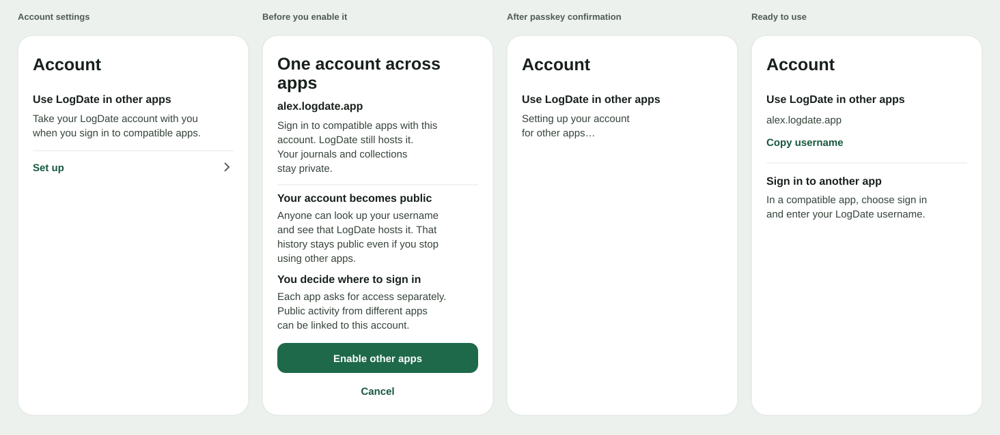

# Per-account identity publication

A person who uses LogDate as their Atmosphere host can make their LogDate
identity available to other apps. Every hosted identity starts private.
An identity hosted elsewhere keeps its existing host and public standing.

## Use your LogDate account in other apps

The person is deciding whether to start using their existing LogDate account
across compatible apps. Place **Use LogDate in other apps** in native Account
settings. The entry explains the benefit and opens setup. The same destination
becomes the place to find the username and learn how to sign in elsewhere.

The review shows the exact username and explains the consequences together:

- **One account across apps.** Compatible apps can offer sign-in with this account.
  LogDate continues to host it, and the person continues using their journals and collections as usual.
- **A public account history.** Other apps can look up the username and see that
  LogDate hosts the account. The public account history keeps the information already
  shared even if the person stops using other apps. If setup would also disclose
  earlier account changes, put **Earlier account changes** directly under this
  explanation before confirmation. For example, “A change to how you recover
  this account will also become public.” Use the review’s change counts to
  distinguish changes to recovery from changes to how the account verifies
  activity. The review derives these counts from the exact signed history
  bound to confirmation and never exposes raw key material.
- **Separate permissions.** Your journals and collections stay private. Using another app requires
  its own sign-in and authorization. What the person chooses to share in another
  app can be visible beyond LogDate and is subject to that app’s controls.
  Public activity in different apps can be linked to the same account.

Use **Enable other apps** and **Cancel**. Confirmation uses a fresh passkey
bound to this account, the exact DID, and the digest of the reviewed operations.
Changing the handle, keys, host, or operation chain invalidates the review.
Leaving before confirmation keeps the account private.

Show **Setting up your account for other apps…** until read-back confirms
publication. After confirmation, show the username and **Copy username**, with
the steps to sign in through a compatible app. Only show app-specific guidance
after that sign-in path has been verified. Any app password is created by a
separate action for a public account.

## Publication and recovery

Separate directory transport availability from authorization to publish.
Account creation, handle discovery, key enrollment, and the operator
inventory must never publish a private identity as a side effect. Retire
the environment switch that enables automatic publication for new
accounts. The command may inspect or reconcile an existing authorized
operation. It cannot create publication authority.

Before offering the confirmation, validate the locally stored signed chain
and derive the exact DID from its genesis operation. Its final operation
must name the reviewed handle, LogDate’s PDS, the current signing key, and
the person’s recovery key ahead of a dedicated server rotation key held
in Cloud KMS. The repository signing key must have no rotation authority
in the final operation. For an older DID, prepare the signed transition
in the private log and show that publishing also exposes its earlier
operations. The confirmation must bind the exact CIDs in the reviewed
chain, including each historical operation sent to the directory.

Store the confirmed account, exact DID, reviewed handle, and immutable
operation chain as durable work before the first external write. Record
whether a request was never sent, may have been sent, or was confirmed.
A worker claims one account at a time and verifies the account still owns
the reviewed identity. An identity change invalidates an unstarted
request. Once transmission has begun, serialize identity changes with
reconciliation so a timeout cannot cause the worker to write a second
identity. Compare any operation already present in the directory before
retrying. A directory history that is an exact prefix can resume at the
first missing reviewed operation. A fork, nullified operation, or different
current head requires investigation and no further writes. A successful
read-back must confirm the expected chain, signing key, rotation order,
and LogDate PDS before the server records the public marker for that DID.
A later handle change or tombstone needs its own review and authorization.

Only after that marker exists may discovery, service authentication,
and eligible public repository reads treat the account as public.
Journals, collections, their records, and their media remain private. Publishing the identity does
not grant consent to publish any individual record.

## Signing in to apps that require a password

When a verified compatible app needs a password, its setup guide links to
**Create app password** in native Account settings. This action is available
only after the current LogDate-hosted identity is public. Show the app name,
what the password permits, and how to revoke access before requesting a fresh
passkey. LogDate generates the password and shows it once. The app name and
creation date remain in Account settings, with an action to revoke the password
and end sessions it started.

Keep the main LogDate account passkey-only. The PDS accepts only generated app
passwords for this path, using the current public handle or DID. It neither
provisions an identity during credential exchange nor accepts a password for
private, external, suspended, or superseded identities. Check this boundary at
credential creation, exchange, refresh, and authenticated use. Treat a missing
account, wrong secret, or ineligible identity as the same login failure.

Bind each credential and its session family to the exact public DID. Persist a
verifier for the generated secret and return the secret once over the
authenticated response. Associate access and refresh sessions with the
credential so revocation applies to both. Limit these sessions to the public
repository and approved service proxy. They cannot read journals, collections
or media, manage LogDate account settings, or create another app password.
Apply rate limits to password exchange and exclude the secret from request
logs, telemetry, and error responses.

The existing password-account creation and verification service was designed
for account-wide passwords. Keep those routes refused until the generated
credential and restricted session paths are wired and verified. The fixture
must prove that another app can sign in with a dedicated password, that its
session cannot reach private data, and that revocation ends existing access
and prevents refresh and new sessions.

## Acceptance

Use an isolated directory fixture to prove explicit consent, cancellation,
invalidation after identity changes, repeat submission, and recovery
after a directory write with a lost response. Verify that ordinary
account creation and operator inventory produce zero directory writes.
Prove forward and reverse handle resolution against the disposable
directory, including a private-account control. Check that the recovery
key can rotate the identity and that the repository signing key cannot.
Inspect the rendered native review in compact and large text layouts.
Production publication requires separate authorization.
